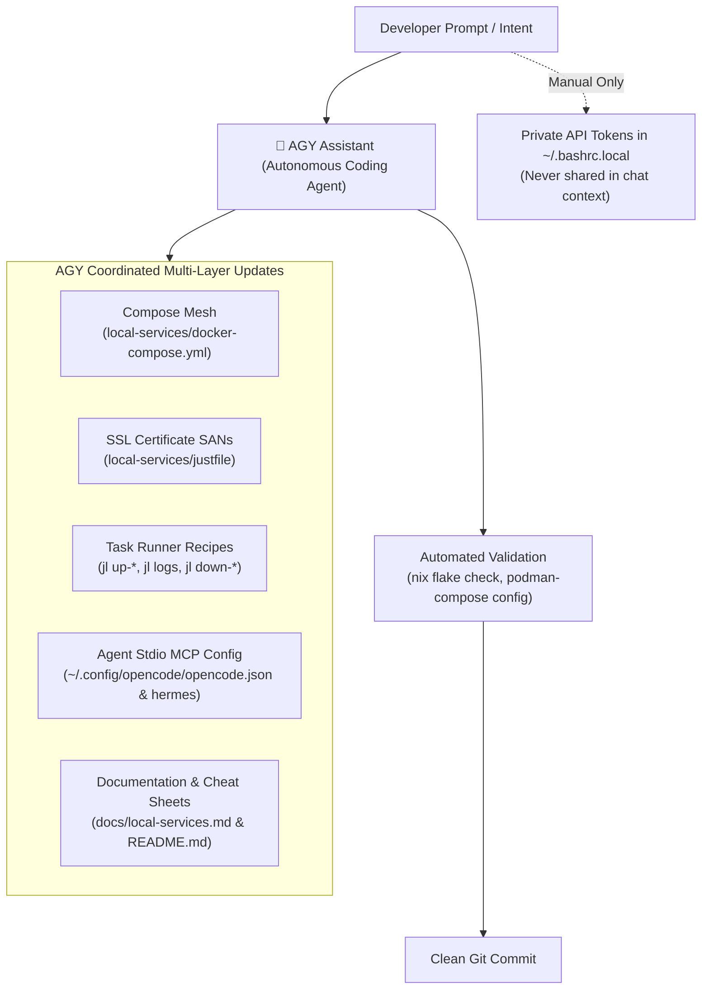

# 🌙 Project State & Resumption Context

**Timestamp**: 2026-10-15 00:20 (US/Pacific)  
**Workspace**: `/home/thsieh/_Projects/setup-linux-scripts`  
**Host Environment**: CachyOS Linux (`envy-cachyos-x8664`), User: `thsieh`  
**Active Architecture**: Declarative Nix Flakes (v2.0) + Home Manager + Devenv + Rootless Podman Mesh  
**Status**: 100% Implemented, Verified, Cleaned, & Committed ✅  
**Current Git HEAD**: `083e041` (synchronized with `origin/main`)

---

## 📌 1. Executive Summary & Achievements Tonight

Tonight's session achieved two major milestones: robust upgrade/cleanup automation for existing systems, and the full implementation of the **Option A: Modular AI & Homelab Mesh**:

1. **Upgrade Lifecycle & Existing Deployment Detection**:
   - Added automated pre-flight detection (`detect_existing_deployments`) in [`bootstrap.sh`](bootstrap.sh) that scans for shadowed binaries in `/usr/local/bin` and `~/.local/bin`, stale dotfile backups (`.bashrc.bak`, `.tmux.conf.bak`), obsolete directories (`~/.tmux/plugins/tpm`, `~/.local/share/blesh`), and imperative `nix profile` packages.
   - Added post-switch automated health verification self-tests (`verify_deployment`) testing core tools (`starship`, `git`, `tmux`, `nvim`, `direnv`, `just`) and configuration links.
   - Added interactive and automated cleanup options (`offer_and_run_cleanup`, `--cleanup` / `--clean`, and `--no-cleanup`).
   - Added multi-user profile support in [`flake.nix`](flake.nix) and [`bootstrap.sh`](bootstrap.sh) for both `thsieh` and `thsieh01` on CachyOS / Arch Linux.

2. **CachyOS / Arch Rolling-Release Pacman Resolution**:
   - Diagnosed root cause of HTTP 404 package errors during `./bootstrap.sh --with-host-deps`: local package databases were 2 weeks old, and upstream mirrors had replaced package tarballs.
   - Updated `pacman` installation logic in [`bootstrap.sh`](bootstrap.sh) to always synchronize databases first (`pacman -Sy`) and added automated mirror failure recovery (automatically running `cachyos-rate-mirrors` and `pacman -Syy` if mirror resolution fails).
   - Documented **Step 0: Host System Preparation** (mirror ranking and system upgrades) and the comprehensive recommended command (`./bootstrap.sh --with-host-deps --cleanup`) in [`README.md`](README.md).

3. **Option A: Modular AI & Homelab Mesh ([`next-feature-plan.md`](next-feature-plan.md))**:
   - **Ollama Local LLM Inference Engine**:
     - Configured in [`local-services/docker-compose.yml`](local-services/docker-compose.yml) under profile `profiles: ["llm"]`.
     - Routed dynamically through Traefik ingress at `https://ollama.localhost` and exposed on `0.0.0.0:11434`.
     - Added task runner commands in [`local-services/justfile`](local-services/justfile): `jl up-llm`, `jl down-llm`, `jl llm-pull <model>`, `jl llm-list`, and `jl llm-status`.
   - **Kavita E-Book, Comic, & Manga Reader**:
     - Configured under profile `profiles: ["books", "apps"]` routing to `https://kavita.localhost`.
     - Automatically mounts `${BOOKS_DIR:-$HOME/Books}` and persistent database volume.
     - Added task runner commands: `jl up-books`, `jl down-books`.
   - **Plex Media Server**:
     - Configured under profile `profiles: ["media"]` routing to `https://plex.localhost` and port `32400`.
     - Automatically mounts `${MEDIA_DIR:-$HOME/Media}` and persistent configuration volume.
     - Added task runner commands: `jl up-media`, `jl down-media`, and `jl up-all`.
   - **Local & Hosted LLM Credential Stubs**:
     - Updated [`bootstrap.sh`](bootstrap.sh) to automatically scaffold `~/.bashrc.local` if missing with clean stubs for Google Gemini, OpenRouter, Groq, and local Ollama (`OPENAI_BASE_URL="http://localhost:11434/v1"`).
   - **Wildcard SSL Coverage**:
     - Updated `jl certs` to guarantee SANs for `*.localhost`, `pdf.localhost`, `traefik.localhost`, `ollama.localhost`, `kavita.localhost`, and `plex.localhost`.
   - **Documentation**:
     - Extensively expanded [`docs/local-services.md`](docs/local-services.md) with dedicated sections for Ollama, Kavita, and Plex.
     - Updated the services and command cheat sheets in [`README.md`](README.md).

---

## 🚦 2. Current Status & Verification

* **Git HEAD**: `083e041` on `main` (clean working tree).
* **Docker Compose Configuration**: Evaluated and validated cleanly via `podman-compose config`.
* **Host Runtime**: Rootless Podman and podman-compose installed on host CachyOS machine.
* **Bootstrap Script**: Fully verified with `--help`, `--build`, `--cleanup`, and `--no-cleanup` modes.

---

## 🤖 3. Advisory: Recommended Way to Add MCP and Other Services

### Question:
> *"What is the recommended way to add MCP and other services... manually or using agy to help?"*

### 🏆 Recommendation: **Use AGY (`agy`) as your primary pair-programming driver, keeping manual input reserved only for private secrets.**

Here is the breakdown of why and how this hybrid approach works best:



#### Why AGY is Strongly Recommended for Adding Services & MCP Tools:
1. **Multi-File Synchronization**:
   Adding a single service (e.g., Redis, MinIO, or an MCP server) touches at least 4 files simultaneously:
   - `local-services/docker-compose.yml` (labels, ports, profiles, networks, volumes)
   - `local-services/justfile` (task recipes, wildcard SAN list)
   - `~/.config/opencode/opencode.json` / `~/.hermes/config.yaml` (MCP definitions)
   - `docs/local-services.md` and `README.md` (documentation)
   Doing this manually is tedious and prone to typos; AGY applies all modifications consistently in seconds.
2. **Strict Schema & Traefik Syntax Adherence**:
   Traefik labels require specific formatting (e.g. Escaped backticks `Host(\`app.localhost\`)`, exact entrypoints, load balancer ports). AGY guarantees syntax correctness and tests it immediately with `podman-compose config`.
3. **Zero-RAM Stdio MCP Patterns**:
   For MCP tools (e.g. GitHub MCP, SQLite MCP, Puppeteer MCP), running them containerized via rootless Podman stdio (`podman run -i --rm ...`) prevents memory leaks. AGY knows the exact JSON-RPC stdio arguments (`--init`, `--rm`, `-i`) required by OpenCode, Hermes, and Claude.
4. **Instant Rollback & Evaluation**:
   AGY validates changes before activation, verifying Nix flake syntax (`nix flake check`) and Compose structure.

#### The Ideal Workflow:
* **Let AGY do**: Service definition, Traefik routing, `justfile` task commands, documentation updates, and MCP stdio integration.
  * *Example Prompt*: `"Add a Redis service under profile 'cache' to Tier 2 with jl up-redis and route through Traefik at redis.localhost."`
  * *Example Prompt*: `"Add the GitHub MCP server to OpenCode and Hermes via containerized rootless Podman stdio."`
* **Do Manually**: Adding real, private API keys or personal tokens into `~/.bashrc.local` (e.g., your actual GitHub PAT or Gemini API key). This keeps sensitive credentials out of chat logs and prompts.

---

## 📋 4. Next Steps for Resumption Tomorrow

When you resume tomorrow, choose from the following prioritized actions:

### 1. Finalize Host Environment Activation
If your background `./bootstrap.sh --with-host-deps` completed, reload your shell and verify:
```bash
exec bash
./bootstrap.sh --cleanup
jl status
```

### 2. Test Local LLM Inference (Ollama)
Launch Ollama, pull a lightweight coding model, and test local inference:
```bash
jl up-llm
jl llm-pull qwen2.5-coder:1.5b    # or: jl llm-pull qwen2.5-coder:7b
jl llm-list
curl -s http://localhost:11434/api/tags | jq .
```
Verify the trusted SSL endpoint at [https://ollama.localhost](https://ollama.localhost) in your browser.

### 3. Configure AI Agent API Keys
Edit `~/.bashrc.local` to plug in any hosted keys you'd like to use:
```bash
nvim ~/.bashrc.local
```
*(Add `GEMINI_API_KEY`, `OPENROUTER_API_KEY`, or uncomment `OPENAI_BASE_URL="http://localhost:11434/v1"` to route OpenCode to local Ollama).*

### 4. Hands-On Practice: Sander van Vugt CKAD Environment
Scaffold and test the Kubernetes course repository in an isolated workspace:
```bash
mkdir -p ~/projects/ckad-practice && cd ~/projects/ckad-practice
nix flake init -t github:TonyHsieh/setup-linux-scripts#ckad
direnv allow
minikube start --driver=podman --container-runtime=containerd
k get nodes
```
