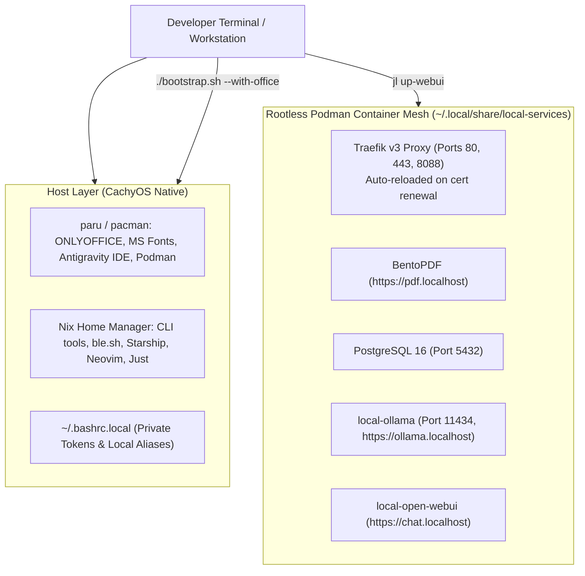

# 🌙 Project State & Resumption Context

**Timestamp**: 2026-10-16 23:49 (US/Pacific)  
**Workspace**: `/home/thsieh/_Projects/setup-linux-scripts`  
**Host Environment**: CachyOS Linux (`envy-cachyos-x8664`), User: `thsieh`  
**Active Architecture**: Declarative Nix Flakes (v2.0) + Home Manager + Devenv + Rootless Podman Mesh  
**Status**: 100% Implemented, Verified, Cleaned, & Committed ✅  
**Current Git HEAD**: `f725040` (synchronized with `origin/main`)

---

## 📌 1. Executive Summary & Session Achievements

During this session, we resolved critical SSL trust and agent behaviors, clarified architecture for GUI tools and shell configurations, and extended the system with automated local office capabilities:

### 1.1 SSL Ingress & Firefox Certificate Trust for `https://chat.localhost`
* **Root Cause 1 (Firefox Trust Store Divergence)**: On Arch Linux and CachyOS, Firefox strictly follows the XDG specification and stores user profiles in `~/.config/mozilla/firefox/` (`dlzqinyy.default-release`). Upstream `mkcert -install` only looks in `~/.mozilla/firefox/`, leaving the root CA completely missing from Firefox's `cert9.db`.
* **Root Cause 2 (Traefik In-Memory Cert Cache)**: Traefik was serving the previous certificate from memory which lacked `chat.localhost` in its Subject Alternative Name (SAN) list.
* **Fix & Automation**:
  - Injected `mkcert development CA` (`C,,`) directly into `/home/thsieh/.config/mozilla/firefox/dlzqinyy.default-release/cert9.db` via `certutil`.
  - Updated [`bootstrap.sh`](bootstrap.sh#L498-L514) to automatically scan both `~/.mozilla/firefox` and `~/.config/mozilla/firefox` for `cert9.db` profiles and register the mkcert Root CA on every run, along with creating a compatibility symlink.
  - Updated [`local-services/justfile`](local-services/justfile#L136-L139) to automatically restart `traefik-ingress` whenever certificates are generated or regenerated.
  - Verified: `curl -I https://chat.localhost` returns `HTTP/2 200` with 0 SSL errors.

### 1.2 OpenCode Agent vs. Chatbot Behavior & 1.5B Model Limitations
* **Problem**: Running `oc run "Write a Python script..."` returned raw JSON tool-calling constructs (`{ "name": "write", "arguments": ... }`) instead of plain Python code.
* **Explanation**:
  - OpenCode defaults to the `build` agent mode, which treats code prompts as requests to create/edit files on disk using its built-in `write` tool.
  - Tiny models like `qwen2.5-coder:1.5b` lack the parameter capacity for native API function calling tokens and hallucinate the tool schema directly into the message text body.
* **Guidance Provided**:
  - For pure code output without tools: use **Open WebUI** at **`https://chat.localhost`** or `oc run --agent plan ...`.
  - For real autonomous file-writing agents: pull and use a 7B model (`jl llm-pull qwen2.5-coder:7b`).

### 1.3 Linux GUI Applications & Antigravity IDE Strategy
* **Architectural Principle**: Addressed why GUI/Electron IDEs (like Antigravity IDE) belong at the **Host Desktop Layer** (`paru -S antigravity-ide`) rather than inside Nix Home Manager on non-NixOS Linux.
* **Technical Reason**: Non-NixOS Nix packages struggle to link against host GPU/OpenGL/Vulkan drivers (`libGL.so`, Mesa/Nvidia) without brittle workarounds (`nixGL`), causing software rendering and Wayland display lag. Native CachyOS/AUR packages link directly to host drivers and desktop launchers.

### 1.4 Shell Aliases & Secrets Architecture Documentation
* **Clarified Distinction**:
  - **Permanent / Shared**: [`home/shell.nix`](home/shell.nix) under `programs.bash.shellAliases` (Git version-controlled across all machines).
  - **Machine-Specific / Private**: `~/.bashrc.local` (ignored by Git, ideal for private API keys and local machine paths).
* **Documented**: Updated [`README.md`](README.md#L442-L450), [`docs/day-to-day-workflow.md`](docs/day-to-day-workflow.md#L50-L77), and inline comments in [`home/shell.nix`](home/shell.nix#L14-L18).

### 1.5 Nix + Devenv Python Scripting
* Translated legacy `python3 -m venv` + `pip install` commands into a reproducible, isolated **`setup-python-env.sh`** workflow using `devenv.nix`, `direnv`, and high-speed `uv` virtual environments with native C-libraries (`libxml2`, `libxslt`, `zlib` for `lxml`).

### 1.6 Local Office Suite: ONLYOFFICE & Microsoft TrueType Fonts
* **Evaluated Office Suites**: ONLYOFFICE selected for native Microsoft OOXML (`.docx`, `.xlsx`) fidelity, modern ribbon UI, and inclusion in the official CachyOS repository (`cachyos/onlyoffice-bin`).
* **Automated via `bootstrap.sh`**:
  - Added `--with-office` (or `--office`) flag: installs `onlyoffice-bin` and `ttf-ms-fonts` via `paru` and refreshes fontconfig (`fc-cache -f`).
  - Added `--uninstall-office` flag: cleanly removes ONLYOFFICE and Microsoft fonts and updates the font cache.
  - Added automated verification in `verify_deployment()` for ONLYOFFICE.
  - Updated [`README.md`](README.md) documentation and cheat sheet.

---

## 🚦 2. Current Architecture & Service Status



### Active Containers
* `traefik-ingress`: Healthy, routing `*.localhost` with trusted local SSL.
* `bentopdf`: Healthy at `https://pdf.localhost`.
* `local-postgres`: Healthy on `localhost:5432`.
* `local-ollama`: Healthy on `localhost:11434` and `https://ollama.localhost`.
* `local-open-webui`: Healthy on `https://chat.localhost`.

---

## 📦 3. Git Commits Pushed to `origin/main`

* `cb8db58`: `fix(ssl): automate Firefox NSS certificate registration and Traefik reload on cert renewal`
* `8a309e4`: `docs: document permanent vs machine-specific alias and secret placement`
* `f725040`: `feat(bootstrap): add --with-office and --uninstall-office flags for ONLYOFFICE and ms-fonts`

---

## 🚀 4. Action Items & Next Steps for Next Session

### Next Steps (In Priority Order):
1. **Run Office Suite Installation**:
   Execute the newly added flag in your interactive terminal to complete ONLYOFFICE + MS fonts setup:
   ```bash
   ./bootstrap.sh --with-office
   ```
2. **Install Antigravity IDE (Host Layer)**:
   When ready to install the standalone Antigravity IDE on CachyOS:
   ```bash
   paru -S antigravity-ide
   ```
3. **Explore 7B Local Model for Agentic Tool Calling**:
   If you want OpenCode to autonomously create/edit files without JSON string hallucinations:
   ```bash
   jl llm-pull qwen2.5-coder:7b
   oc run -m ollama/qwen2.5-coder:7b "Write a Python script that calculates disk usage"
   ```
4. **Deploy Media/Books Profiles (Optional)**:
   If you wish to activate the remaining container mesh profiles:
   ```bash
   jl up-books    # Starts Kavita (https://kavita.localhost)
   jl up-media    # Starts Plex (https://plex.localhost)
   ```
