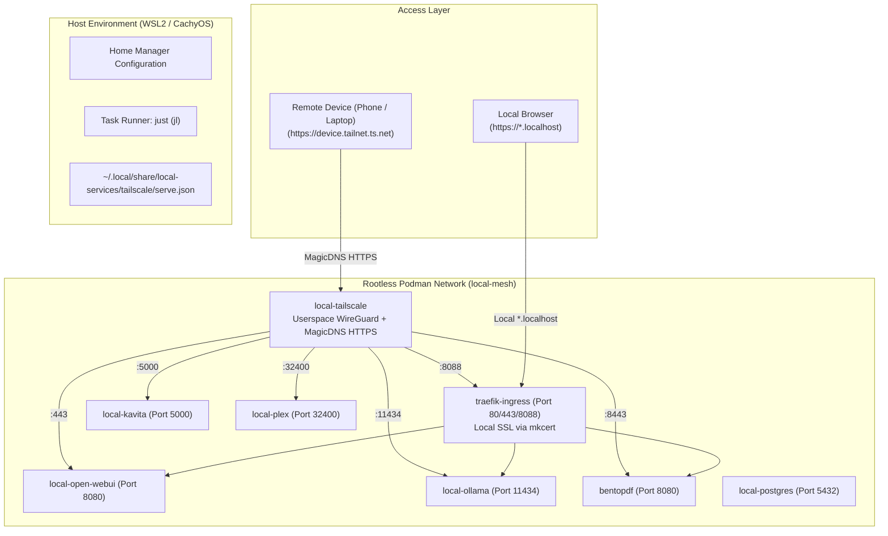

# 🌙 Project State & Resumption Context

**Timestamp**: 2026-10-18 23:10 (US/Pacific)  
**Workspace**: `/home/tonyh/_Projects/setup-linux-scripts`  
**Host Environment**: Ubuntu 24.04.5 LTS on WSL2 (`AsusGA403u`), User: `tonyh`  
**Secondary Supported Environments**: CachyOS Linux (`envy-cachyos-x8664`), User: `thsieh`; Arch Linux, User: `thsieh01`; macOS Darwin (`aarch64`/`x86_64`)  
**Active Architecture**: Declarative Nix Flakes (v2.0) + Home Manager + Devenv + Rootless Podman Mesh + Tailscale Userspace WireGuard Mesh  
**Status**: Tailscale Remote Mesh Feature Implemented & Evaluated; Ready for Commit & Testing 🚀  
**Git Base HEAD**: `46ec335` (`docs: add 2026-10-16 session resumption context`)

---

## 📌 1. Executive Summary & Progression Since 2026-10-13

Following the initial 5-phase declarative Nix Flakes & Home Manager migration documented in [`2026-10-13-0016_context.md`](2026-10-13-0016_context.md), subsequent sessions rapidly expanded the ecosystem into an end-to-end, multi-machine developer workstation:

1. **Multi-Machine & Multi-OS Profiles** (`2026-10-13-2305_context.md`):
   - Added Nix Flake matrix in [`flake.nix`](flake.nix) supporting WSL2 (`tonyh`), CachyOS (`thsieh`), Arch (`thsieh01`), and macOS.
   - Created Minikube rootless Podman setup and CKAD exam preparation template (`.#kubernetes` / `.#ckad`).
2. **Local AI Stack & Autonomous Coding Agents** (`2026-10-15-0019_context.md`):
   - Added local Ollama service (`local-ollama`) with GPU passthrough support and Traefik reverse proxying at `https://ollama.localhost`.
   - Wired OpenCode agent and Hermes Agent into local Ollama models and containerized on-demand Puppeteer MCP.
   - Built LLM model management commands into [`local-services/justfile`](local-services/justfile) (`jl llm-pull`, `jl llm-list`).
3. **Open WebUI & Desktop Architecture** (`2026-10-16-2349-context.md`):
   - Added Open WebUI container (`chat.localhost`) for conversational interaction with local LLMs.
   - Resolved Firefox NSS `cert9.db` trust store integration on Arch/CachyOS within [`bootstrap.sh`](bootstrap.sh).
   - Documented host GUI strategy (Electron/IDE tools like Antigravity IDE belong in the native host package manager `paru` to avoid Nix GL/Wayland driver friction).
   - Automated ONLYOFFICE Desktop Editors + MS TrueType fonts installation via `./bootstrap.sh --with-office`.
4. **Current Session Achievement: On-Demand Tailscale Private Mesh Ingress** (Tonight, 2026-10-18):
   - Implemented containerized Tailscale node allowing secure, private access to all laptop services from anywhere in the world (phone, tablet, remote workstation) without opening firewall or router ports.

---

## 🌐 2. Deep Dive: Tailscale Private Mesh Ingress (Tonight's Implementation)

### 2.1 Architecture & Design Decisions
* **Userspace WireGuard (`TS_USERSPACE=true`)**:
  Running Tailscale inside rootless Podman without elevated kernel capabilities (`/dev/net/tun`) requires zero `sudo` or host kernel network modifications.
* **Tailscale Serve vs Funnel**:
  All services are exposed via **Tailscale Serve** with `AllowFunnel` set to `false`. Endpoints are accessible **only** to authenticated devices in the user's private Tailnet, protecting local AI models and databases from the public Internet.
* **Automatic Trusted TLS via MagicDNS**:
  Tailscale automatically provisions and renews valid Let's Encrypt certificates for the machine's MagicDNS name (`<device>.<tailnet>.ts.net`).
* **Declarative Microservice Port Mapping**:
  Configured in [`local-services/tailscale/serve.json`](local-services/tailscale/serve.json):
  * `https://<device>.<tailnet>.ts.net:443` ➔ `local-open-webui:8080` (Chat WebUI)
  * `https://<device>.<tailnet>.ts.net:8443` ➔ `bentopdf:8080` (BentoPDF)
  * `https://<device>.<tailnet>.ts.net:11434` ➔ `local-ollama:11434` (Ollama LLM API)
  * `https://<device>.<tailnet>.ts.net:5000` ➔ `local-kavita:5000` (E-books / Manga)
  * `https://<device>.<tailnet>.ts.net:32400` ➔ `local-plex:32400` (Plex Media)
  * `https://<device>.<tailnet>.ts.net:8088` ➔ `traefik-ingress:8080` (Traefik Ingress Dashboard)

### 2.2 Files Modified / Created
| File | Changes Made |
| :--- | :--- |
| [`local-services/tailscale/serve.json`](local-services/tailscale/serve.json) | **New**: Declarative reverse proxy mapping for all container ports. |
| [`local-services/docker-compose.yml`](local-services/docker-compose.yml) | Added `tailscale` service under `profiles: ["remote", "all"]`, persistent `tailscale-state` volume, and `local-mesh` network attachment. |
| [`local-services/justfile`](local-services/justfile) | Added task runners: `jl up-remote`, `jl down-remote`, `jl remote-status`, `jl remote-info`, `jl remote-auth`. |
| [`home/default.nix`](home/default.nix) | Added `xdg.dataFile."local-services/tailscale/serve.json"` symlink declaration into Home Manager. |
| [`bootstrap.sh`](bootstrap.sh) | Added deployment verification for `~/.local/share/local-services/tailscale/serve.json`. |
| [`docs/local-services.md`](docs/local-services.md) | Added full Section 9: "Secure Remote Access via Tailscale Private Mesh". |
| [`README.md`](README.md) | Updated Quickstart table and task list with remote ingress commands. |

### 2.3 Nix Flake Insight: Relative Path Tracking
> [!IMPORTANT]
> Because [`home/default.nix`](home/default.nix) links `../local-services/tailscale/serve.json`, Nix Flakes requires this new file to be tracked by Git (`git add local-services/tailscale/serve.json` or `git add -N`). Unstaged, untracked files are blocked by the Nix evaluation sandbox. Evaluation has been verified via:
> ```bash
> git add -N local-services/tailscale/serve.json
> nix eval --raw .#homeConfigurations.wsl.activationPackage
> ```

---

## 🚦 3. Current Service Map & Architecture



---

## 📦 4. Git Working Tree Status

Currently uncommitted changes ready to be finalized:
```
 M README.md
 M bootstrap.sh
 M docs/local-services.md
 M home/default.nix
 M local-services/docker-compose.yml
 M local-services/justfile
 A local-services/tailscale/serve.json
```

---

## 🚀 5. Action Items & Instructions for Resuming Next Session

When the next AGY session begins, follow this prioritized checklist:

### Step 1: Commit and Push the Tailscale Mesh Feature
Stage and commit all changes on `main`:
```bash
git add .
git commit -m "feat(local-services): add on-demand Tailscale private mesh ingress with Tailscale Serve"
git push origin main
```

### Step 2: Activate & Authenticate Tailscale Mesh
On the current workstation (or CachyOS laptop):
```bash
# 1. Update Home Manager to symlink the new serve.json
./bootstrap.sh

# 2. Launch the Tailscale container
jl up-remote

# 3. Retrieve the one-time authentication link (if not using TS_AUTHKEY)
jl remote-auth
# Click the login URL to authorize the container in your Tailscale Admin console.

# 4. View your private HTTPS URLs
jl remote-info
```

### Step 3: Test Remote Multi-Device Connectivity
1. From your phone or secondary laptop connected to your Tailnet, open `https://<device>.<tailnet>.ts.net` in the browser.
2. Confirm the Open WebUI ChatGPT-style interface loads over trusted HTTPS.
3. Open `https://<device>.<tailnet>.ts.net:8443` to verify BentoPDF remote access.

### Step 4: Multi-Machine Follow-ups (CachyOS Laptop)
When returning to `envy-cachyos-x8664`:
1. `git pull origin main`
2. Run `./bootstrap.sh --with-office` to finalize ONLYOFFICE and Microsoft TrueType fonts.
3. Install Antigravity IDE at the host desktop layer via `paru -S antigravity-ide`.
4. Pull 7B coding model if needed for heavy agentic tasks: `jl llm-pull qwen2.5-coder:7b`.
