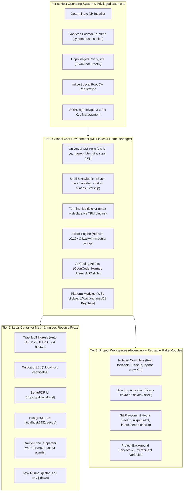

# ❄️ Declarative Developer Environment & Devenv Ecosystem (v2.0)

**Target Systems**: Ubuntu 24.04 (WSL2), CachyOS / Arch Linux, macOS (Darwin)  
**Core Technologies**: Nix Flakes, Home Manager, Devenv, direnv, Rootless Podman, Traefik v3  
**Status**: Declarative, Reproducible, Multi-Platform & Verified ✅  

---

## 🏛️ 1. Architecture Overview (v2.0)

Version 2.0 transforms this repository from imperative shell scripts into a **declarative 3-tier architecture**. Instead of mutating system directories with `apt`, `pacman`, or Homebrew, your entire environment is declared in version-controlled Nix expressions with atomic upgrades and instant rollbacks.



---

## 🚀 2. Quickstart: One-Line Bootstrap

The unified [`bootstrap.sh`](bootstrap.sh) script automatically detects your platform (WSL2, CachyOS, macOS), installs Determinate Nix if missing, and activates your Home Manager configuration.

### Fresh System Installation
```bash
git clone https://github.com/TonyHsieh/setup-linux-scripts.git ~/setup-linux-scripts
cd ~/setup-linux-scripts

# Bootstrap user environment + host dependencies (Podman & port sysctl)
./bootstrap.sh --with-host-deps
```

### Available Bootstrap Flags
* `./bootstrap.sh` — Standard Home Manager switch for current user and auto-detected OS.
* `./bootstrap.sh --with-host-deps` — Also enables host container runtime, port 80/443 sysctl, and local SSL CA trust.
* `./bootstrap.sh --build` — Dry-run build testing flake evaluation without mutating `$HOME`.
* `./bootstrap.sh --profile <name>` — Manually force a profile (`wsl`, `cachyos`, `darwin`).

After bootstrap completes, reload your shell:
```bash
exec bash
```

---

## 🛠️ 3. Creating New Projects with Devenv (Tier 3)

**Golden Rule of v2.0**: *Never install language compilers globally.*  
Instead, every repository declares its own isolated compilers and tools via [Devenv](https://devenv.sh/).

### Quick Project Initialization
Initialize a new project workspace using any of the built-in stack templates:

```bash
mkdir my-new-project && cd my-new-project

# 1. Standard Minimal Starter
nix flake init -t github:TonyHsieh/setup-linux-scripts

# 2. Node.js & TypeScript (Node 22, pnpm, Biome)
nix flake init -t github:TonyHsieh/setup-linux-scripts#node

# 3. Python AI / Backend (Python, uv, ruff)
nix flake init -t github:TonyHsieh/setup-linux-scripts#python

# 4. Systems Rust (Rust toolchain, cargo-watch, rust-analyzer)
nix flake init -t github:TonyHsieh/setup-linux-scripts#rust

# 5. Kubernetes & CKAD (kubectl, minikube, helm, k9s, exam aliases)
nix flake init -t github:TonyHsieh/setup-linux-scripts#kubernetes
```

This creates three starter files in your project directory:
* **`flake.nix`**: The project Nix flake entry point.
* **`devenv.nix`**: Your declarative project dependencies, compilers, and tools.
* **`.envrc`**: Directs `direnv` to automatically load the project environment.

---

### Working with Your Environment (Two Workflows)

#### Workflow A: Automatic Directory Activation with `direnv` (Recommended)
Allow `direnv` once inside the project:
```bash
direnv allow
```
Whenever you `cd` into the project directory, your language compilers, packages, and environment variables **instantly activate**. When you `cd` out, they leave your shell completely clean!

#### Workflow B: Manual Activation via `devenv shell`
If you prefer not to use `direnv`:
```bash
devenv shell
```
Drops you into an interactive subshell with all project tools loaded. Type `exit` to leave.

---

### Concrete `devenv.nix` Examples

#### Example 1: Full-Stack Node.js & TypeScript Project
```nix
{ pkgs, ... }:

{
  # 1. Isolated Language Toolchains
  languages.javascript = {
    enable = true;
    package = pkgs.nodejs_22;
    pnpm.enable = true;
  };
  languages.typescript.enable = true;

  # 2. CLI Utilities for this Project
  packages = with pkgs; [
    docker-compose
    jq
  ];

  # 3. Environment Variables
  env = {
    PORT = "3000";
    NODE_ENV = "development";
  };

  # 4. Git Pre-Commit Quality Checks
  pre-commit.hooks = {
    trailing-whitespace-fixer.enable = true;
    check-json.enable = true;
  };

  enterShell = ''
    echo "⚡ Node.js $(node --version) environment ready!"
  '';
}
```

#### Example 2: Python Data Science & AI Project (uv / venv)
```nix
{ pkgs, ... }:

{
  # 1. Isolated Python Engine
  languages.python = {
    enable = true;
    version = "3.12";
    uv.enable = true;
    venv.enable = true;
  };

  # 2. System Libraries for Native Wheels
  packages = with pkgs; [
    git
    zlib
    stdenv.cc.cc.lib
  ];

  # 3. Environment Variables & Library Paths
  env = {
    PYTHONUNBUFFERED = "1";
    LD_LIBRARY_PATH = "${pkgs.stdenv.cc.cc.lib}/lib";
  };

  enterShell = ''
    echo "🐍 Python $(python --version) + uv active"
    echo "Run 'uv pip install -r requirements.txt' to install libraries"
  '';
}
```

#### Example 3: Systems Rust & Cargo Project
```nix
{ pkgs, ... }:

{
  # 1. Rust Toolchain (Compiler + Linter + Formatter)
  languages.rust = {
    enable = true;
    channel = "stable";
    components = [ "rustc" "cargo" "clippy" "rustfmt" "rust-src" ];
  };

  # 2. Build Dependencies
  packages = with pkgs; [
    pkg-config
    openssl
  ];

  # 3. Pre-Commit Hooks
  pre-commit.hooks = {
    clippy.enable = true;
    rustfmt.enable = true;
  };

  enterShell = ''
    echo "🦀 Rust $(rustc --version) dev shell active"
  '';
}
```

---

## 🚦 4. Local Services & Rootless Container Mesh (Tier 2)

The repository provides a rootless Podman stack with Traefik v3 ingress and automatic `*.localhost` SSL routing.

### Available Services

| Service | Local Endpoint | Description |
| :--- | :--- | :--- |
| **BentoPDF UI** | [https://pdf.localhost](https://pdf.localhost) | Privacy-first PDF merger, compressor, split, and editor |
| **Traefik Dashboard** | [https://traefik.localhost/dashboard/](https://traefik.localhost/dashboard/) | Real-time proxy metrics, router rules, and health |
| **PostgreSQL Database** | `localhost:5432` | Local dev DB (`devuser` / `devpassword` / `devdb`) |
| **Puppeteer MCP** | Stdio (On-demand) | Headless browser scraping tool for AI agents |

### Task Runner Commands (`jl` Alias)
Manage the local services using the `jl` task runner:

```bash
jl status    # View status of running container services
jl up        # Start all local container services in background
jl down      # Stop all local container services
jl restart   # Restart all container services
jl logs      # Follow real-time service logs (or: jl logs bentopdf)
jl certs     # Regenerate local wildcard SSL certificates
jl mcp-info  # Show OpenCode & Hermes MCP connection snippets
```

> [!TIP]
> For a full guide on connecting databases, configuring custom services, and updating certificates, read **[docs/local-services.md](docs/local-services.md)**.

---

## 🤖 5. Terminal AI Agents & MCP Tooling

Modern AI developer agents are provisioned and pre-configured out of the box:

* **[OpenCode](https://opencode.ai/)** (`opencode` / shorthand `oc`): Open-source pair programming agent.
  - Pre-configured with the **Google Antigravity (`agy`)** skill and `/agy` command.
  - Pre-configured with containerized on-demand **Puppeteer MCP**.
* **[Hermes Agent](https://nousresearch.com/)** (`hermes` / shorthand `ha`): Autonomous research and development agent by Nous Research.
  - Pre-configured with containerized on-demand **Puppeteer MCP**.
* **[Google Antigravity CLI](https://antigravity.google.com)** (`agy`): Deep reasoning and Google Cloud orchestration tool.

### Testing Puppeteer MCP
Agents run Puppeteer on-demand via container stdio (`podman run --rm -i docker.io/mcp/puppeteer:latest`). You can test the engine anytime:
```bash
echo '{"jsonrpc": "2.0", "id": 1, "method": "initialize", "params": {"protocolVersion": "2024-11-05", "capabilities": {}, "clientInfo": {"name": "test", "version": "1.0"}}}' | podman run --rm -i docker.io/mcp/puppeteer:latest
```

---

## ⚡ 6. Common Day-to-Day Commands Cheat Sheet

| Category | Command | Description |
| :--- | :--- | :--- |
| **Nix Environment** | `./bootstrap.sh` | Apply declarative changes from this repo |
| **Nix Flake Check** | `nix flake check` | Validate syntax and schema of flake definitions |
| **Devenv Info** | `devenv info` | View active compilers and packages in a project |
| **Devenv Processes** | `devenv up` | Start background services declared in `devenv.nix` |
| **Container Mesh** | `jl status` | View local container status |
| **Container Mesh** | `jl restart` | Restart Traefik, BentoPDF, and PostgreSQL |
| **PostgreSQL CLI** | `psql -h localhost -U devuser -d devdb` | Native host CLI connection to dev database |
| **Git Shorthands** | `gs`, `gd`, `gl`, `gc`, `gp` | Fast git status, diff, log graph, commit, push |
| **AI Agents** | `oc` / `ha` | Shorthand for `opencode` and `hermes` |
| **Kubernetes** | `k` | Shorthand for `kubectl` |

---

## 🔄 7. Rollback & Generation Management

Nix Home Manager keeps a history of every change made to your user profile:

```bash
# List all previous generations
home-manager generations

# Roll back to a specific generation ID
home-manager switch --generation <ID>
```

---

## ⚠️ 8. Legacy Scripts Archive (v1.x)

The original procedural scripts and templates are archived under [`legacy/`](legacy/README.md) for historical reference:
- [`legacy/install-dev-env.sh`](legacy/install-dev-env.sh)
- [`legacy/install-local-services.sh`](legacy/install-local-services.sh)
- [`legacy/uninstall-dev-env.sh`](legacy/uninstall-dev-env.sh)

> [!CAUTION]
> **Do not run `legacy/uninstall-dev-env.sh` on an active Nix installation.**  
> It was designed for the imperative v1.x setup and will delete or unlink active Home Manager symlinks. For safe legacy pruning steps, consult [`2026-10-13-0016_context.md`](2026-10-13-0016_context.md).

