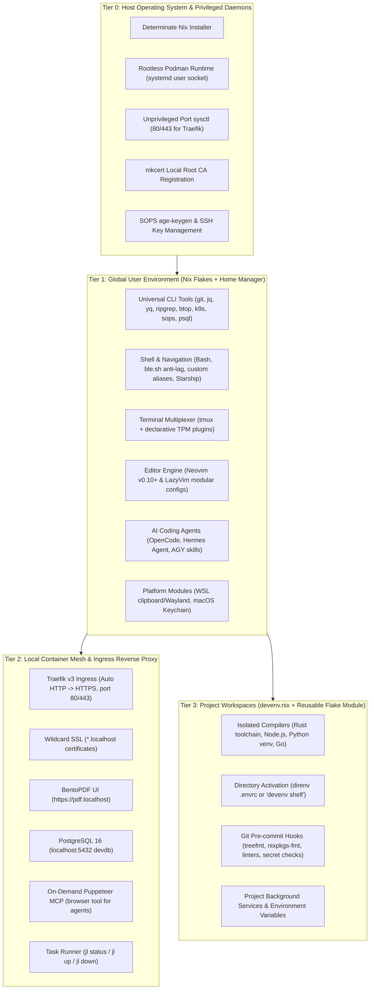
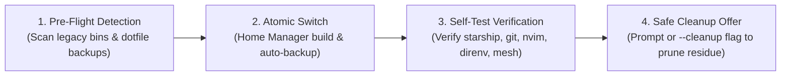

# ❄️ Declarative Developer Environment & Devenv Ecosystem (v2.0)

**Target Systems**: Ubuntu 24.04 (WSL2), CachyOS / Arch Linux, macOS (Darwin)  
**Core Technologies**: Nix Flakes, Home Manager, Devenv, direnv, Rootless Podman, Traefik v3  
**Status**: Declarative, Reproducible, Multi-Platform & Verified ✅  

---

## 🏛️ 1. Architecture Overview (v2.0)

Version 2.0 transforms this repository from imperative shell scripts into a **declarative 3-tier architecture**. Instead of mutating system directories with `apt`, `pacman`, or Homebrew, your entire environment is declared in version-controlled Nix expressions with atomic upgrades and instant rollbacks.



---

## 🚀 2. Quickstart: One-Line Bootstrap

The unified [`bootstrap.sh`](bootstrap.sh) script automatically detects your platform (WSL2, CachyOS, macOS), installs Determinate Nix if missing, and activates your Home Manager configuration.

### ⚙️ Step 0: Host System Preparation (Optional, Highly Recommended)

Before running the bootstrap script—especially on rolling-release systems like CachyOS/Arch or machines that haven't updated package databases recently—it is strongly recommended to refresh system mirrors and update host packages. This eliminates HTTP 404 package errors during container runtime and host tool setup:

#### CachyOS / Arch Linux
```bash
# 1. Update and rank mirrors to the fastest, active servers
sudo cachyos-rate-mirrors   # or: rate-mirrors arch | sudo tee /etc/pacman.d/mirrorlist

# 2. Synchronize databases & upgrade system packages
sudo pacman -Syu
```

#### Ubuntu / Debian (WSL2)
```bash
sudo apt-get update && sudo apt-get upgrade -y
```

#### macOS (Darwin)
```bash
brew update && brew upgrade
```

---

### 🌟 Recommended All-In-One Bootstrap Command

To deploy or upgrade your entire developer environment with host container prerequisites, local SSL ingress, automated self-tests, and legacy artifact cleanup in a single execution:

```bash
git clone https://github.com/TonyHsieh/setup-linux-scripts.git ~/setup-linux-scripts
cd ~/setup-linux-scripts

# Comprehensive bootstrap (Host dependencies + automated legacy cleanup verification):
./bootstrap.sh --with-host-deps --cleanup
```

#### What this combined command does:
1. **`--with-host-deps`**:
   - Synchronizes databases and installs Podman and container tools via host package managers (`pacman`, `apt`, `brew`).
   - Enables the rootless Podman user systemd socket (`podman.socket`).
   - Configures `/etc/sysctl.d/` unprivileged port start (`80`/`443`) for Traefik ingress.
   - Installs and registers the local root CA and generates wildcard `*.localhost` SSL certificates via `mkcert`.
2. **`--cleanup`** (or `--clean`):
   - Catalogs any legacy v1.x tools, duplicate binaries in `/usr/local/bin`, stale dotfile backups, and obsolete directories.
   - Atomically switches to the new declarative Nix Home Manager profile.
   - Executes an automated verification self-test on core tools (`starship`, `git`, `tmux`, `nvim`, `direnv`, `just`).
   - Automatically prunes confirmed legacy residue without requiring interactive prompts.

*(Optional dry-run preview)*: If you want to evaluate and verify flake generation without modifying `$HOME` or installing files:
```bash
./bootstrap.sh --build
```

### 🔄 Installing Over an Existing Version or Upgrading

If you are running `bootstrap.sh` on an existing machine—whether upgrading an active Nix Home Manager configuration or migrating from the legacy v1.x imperative shell scripts—`bootstrap.sh` safeguards your workflow through an automated 4-stage lifecycle:



1. **Pre-Flight Detection**:
   Scans for historical artifacts from previous installs without modifying them:
   - **Shadowed / Duplicate Host Binaries**: Stale binaries in `/usr/local/bin` or `~/.local/bin` (e.g., `nvim`, `k9s`, `starship`, `minikube`, `flux`, `argocd`, `sops`) that could shadow or collide with Nix packages.
   - **Stale Dotfile Backups**: Obsolete backup files (`~/.bashrc.bak`, `~/.tmux.conf.bak`, and older `~/.bashrc.backup-*`).
   - **Obsolete Residue Directories**: Legacy tool directories superseded by declarative Nix (e.g., `~/.tmux/plugins/tpm`, `~/.local/share/blesh`, `~/.local/share/lunarvim`).
   - **Imperative Nix Profile Collisions**: Packages imperatively installed via `nix profile install` (e.g., legacy `devenv`).

2. **Atomic Switch & Safe Backup**:
   Home Manager compiles your new environment first. Existing active dotfiles (`~/.bashrc`, `~/.tmux.conf`) are backed up automatically with a timestamp (`.$BACKUP_EXT`) before new declarative symlinks are applied.

3. **Self-Test Verification**:
   Before asking to delete any old files, `bootstrap.sh` executes an automated health check:
   - Verifies core CLI tools (`starship`, `git`, `tmux`, `nvim`, `direnv`, `just`) in `~/.nix-profile/bin`.
   - Verifies shell integration in `~/.bashrc`.
   - Verifies Tier 2 container mesh configs in `~/.local/share/local-services/`.

4. **Interactive or Automated Cleanup Offer**:
   - **Interactive Terminal**: Displays an itemized inventory of detected legacy files and offers an interactive confirmation prompt:
     ```bash
     Would you like to clean up these legacy / duplicate artifacts now? (y/N)
     ```
   - **Automatic Cleanup (`--cleanup` or `--clean`)**: Runs the switch, passes self-tests, and automatically cleans up detected legacy artifacts without prompting.
   - **Preserve All Backups (`--no-cleanup`)**: Skips the cleanup prompt and leaves all existing backups intact.

### Available Bootstrap Flags

| Flag | Purpose | Recommended Use |
| :--- | :--- | :--- |
| `./bootstrap.sh` | Standard declarative activation with interactive cleanup prompt | Upgrades and day-to-day sync |
| `./bootstrap.sh --with-host-deps` | Enables rootless Podman, port 80/443 sysctl, and local SSL CA trust | First-time machine setup |
| `./bootstrap.sh --with-office` (or `--office`) | Installs ONLYOFFICE Desktop Editors & Microsoft TrueType fonts | Local office suite setup |
| `./bootstrap.sh --uninstall-office` | Uninstalls ONLYOFFICE Desktop Editors and Microsoft TrueType fonts | Remove local office suite |
| `./bootstrap.sh --cleanup` (or `--clean`) | Automatically cleans up detected legacy/duplicate artifacts after self-test verification | Automated installs & clean upgrades |
| `./bootstrap.sh --no-cleanup` | Skips legacy artifact detection and keeps all backups intact | Safe testing without touching old files |
| `./bootstrap.sh --build` (or `--dry-run`) | Dry-run build testing flake evaluation without mutating `$HOME` | CI, validation, syntax checks |
| `./bootstrap.sh --profile <name>` | Manually specify target profile (`wsl`, `cachyos`, `darwin`) | Testing cross-platform profiles |

After bootstrap completes, reload your shell:
```bash
exec bash
```

---

## 🛠️ 3. Creating New Projects with Devenv (Tier 3)

**Golden Rule of v2.0**: *Never install language compilers globally.*  
Instead, every repository declares its own isolated compilers and tools via [Devenv](https://devenv.sh/).

### Quick Project Initialization
Initialize a new project workspace using any of the built-in stack templates:

```bash
mkdir my-new-project && cd my-new-project

# 1. Standard Minimal Starter
nix flake init -t github:TonyHsieh/setup-linux-scripts

# 2. Node.js & TypeScript (Node 22, pnpm, Biome)
nix flake init -t github:TonyHsieh/setup-linux-scripts#node

# 3. Python AI / Backend (Python, uv, ruff)
nix flake init -t github:TonyHsieh/setup-linux-scripts#python

# 4. Systems Rust (Rust toolchain, cargo-watch, rust-analyzer)
nix flake init -t github:TonyHsieh/setup-linux-scripts#rust

# 5. Kubernetes & CKAD (kubectl, minikube, helm, k9s, exam aliases)
nix flake init -t github:TonyHsieh/setup-linux-scripts#kubernetes
```

This creates three starter files in your project directory:
* **`flake.nix`**: The project Nix flake entry point.
* **`devenv.nix`**: Your declarative project dependencies, compilers, and tools.
* **`.envrc`**: Directs `direnv` to automatically load the project environment.

---

### Working with Your Environment (Two Workflows)

#### Workflow A: Automatic Directory Activation with `direnv` (Recommended)
Allow `direnv` once inside the project:
```bash
direnv allow
```
Whenever you `cd` into the project directory, your language compilers, packages, and environment variables **instantly activate**. When you `cd` out, they leave your shell completely clean!

#### Workflow B: Manual Activation via `devenv shell`
If you prefer not to use `direnv`:
```bash
devenv shell
```
Drops you into an interactive subshell with all project tools loaded. Type `exit` to leave.

---

### Concrete `devenv.nix` Examples

#### Example 1: Full-Stack Node.js & TypeScript Project
```nix
{ pkgs, ... }:

{
  # 1. Isolated Language Toolchains
  languages.javascript = {
    enable = true;
    package = pkgs.nodejs_22;
    pnpm.enable = true;
  };
  languages.typescript.enable = true;

  # 2. CLI Utilities for this Project
  packages = with pkgs; [
    docker-compose
    jq
  ];

  # 3. Environment Variables
  env = {
    PORT = "3000";
    NODE_ENV = "development";
  };

  # 4. Git Pre-Commit Quality Checks
  pre-commit.hooks = {
    trailing-whitespace-fixer.enable = true;
    check-json.enable = true;
  };

  enterShell = ''
    echo "⚡ Node.js $(node --version) environment ready!"
  '';
}
```

#### Example 2: Python Data Science & AI Project (uv / venv)
```nix
{ pkgs, ... }:

{
  # 1. Isolated Python Engine
  languages.python = {
    enable = true;
    version = "3.12";
    uv.enable = true;
    venv.enable = true;
  };

  # 2. System Libraries for Native Wheels
  packages = with pkgs; [
    git
    zlib
    stdenv.cc.cc.lib
  ];

  # 3. Environment Variables & Library Paths
  env = {
    PYTHONUNBUFFERED = "1";
    LD_LIBRARY_PATH = "${pkgs.stdenv.cc.cc.lib}/lib";
  };

  enterShell = ''
    echo "🐍 Python $(python --version) + uv active"
    echo "Run 'uv pip install -r requirements.txt' to install libraries"
  '';
}
```

#### Example 3: Systems Rust & Cargo Project
```nix
{ pkgs, ... }:

{
  # 1. Rust Toolchain (Compiler + Linter + Formatter)
  languages.rust = {
    enable = true;
    channel = "stable";
    components = [ "rustc" "cargo" "clippy" "rustfmt" "rust-src" ];
  };

  # 2. Build Dependencies
  packages = with pkgs; [
    pkg-config
    openssl
  ];

  # 3. Pre-Commit Hooks
  pre-commit.hooks = {
    clippy.enable = true;
    rustfmt.enable = true;
  };

  enterShell = ''
    echo "🦀 Rust $(rustc --version) dev shell active"
  '';
}
```

#### Example 4: Kubernetes & CKAD Study Stack
```nix
{ pkgs, ... }:

{
  packages = with pkgs; [
    kubectl
    minikube
    kubernetes-helm
    k9s
    kustomize
    yq-go
    jq
  ];

  enterShell = ''
    alias k=kubectl
    complete -o default -F __start_kubectl k 2>/dev/null || true
    source <(kubectl completion bash 2>/dev/null) 2>/dev/null || true

    export do="--dry-run=client -o yaml"
    export now="--force --grace-period=0"

    echo "☸️  CKAD & Kubernetes Environment Loaded!"
  '';
}
```

> [!TIP]
> **Taking Kubernetes courses like Sander van Vugt's CKAD?**  
> Never run course scripts that mutate `/usr/local/bin` or `apt`. Follow our step-by-step case study in **[`docs/day-to-day-workflow.md`](docs/day-to-day-workflow.md)** to run course labs in an isolated Minikube + Podman container environment.

---

## 🚦 4. Local Services & Rootless Container Mesh (Tier 2)

The repository provides a rootless Podman stack with Traefik v3 ingress and automatic `*.localhost` SSL routing.

### Available Services

| Service | Local Endpoint | Profile | Description |
| :--- | :--- | :--- | :--- |
| **BentoPDF UI** | [https://pdf.localhost](https://pdf.localhost) | Default | Privacy-first PDF merger, compressor, split, and editor |
| **Traefik Dashboard** | [https://traefik.localhost/dashboard/](https://traefik.localhost/dashboard/) | Default | Real-time proxy metrics, router rules, and health (port 8088) |
| **PostgreSQL Database** | `localhost:5432` | Default | Local dev DB (`devuser` / `devpassword` / `devdb`) |
| **Ollama Local LLM** | [https://ollama.localhost](https://ollama.localhost) | `llm` | Offline LLM inference engine & OpenAI-compatible endpoint (port 11434) |
| **Kavita Reader** | [https://kavita.localhost](https://kavita.localhost) | `books` / `apps` | E-book, digital comic, and manga reader UI (mounts `$HOME/Books`) |
| **Plex Media Server** | [https://plex.localhost](https://plex.localhost) | `media` | Local media streaming server (mounts `$HOME/Media`, port 32400) |
| **Puppeteer MCP** | Stdio (On-demand) | Agent Tool | Headless browser scraping tool for AI agents (zero idle RAM) |

### Task Runner Commands (`jl` Alias)
Manage the local services using the `jl` task runner:

```bash
# Core Services
jl status       # View status of running container services
jl up           # Start core container mesh (Traefik, BentoPDF, PostgreSQL)
jl down         # Stop all local container services
jl restart      # Restart all container services
jl logs         # Follow real-time service logs (or: jl logs bentopdf)
jl certs        # Regenerate local wildcard SSL certificates (*.localhost)
jl mcp-info     # Show OpenCode & Hermes MCP connection snippets

# 🦙 On-Demand Local LLM & Web UI (Ollama & Open WebUI)
jl up-llm       # Start Ollama service on https://ollama.localhost & port 11434
jl down-llm     # Stop Ollama service
jl up-webui     # Start Open WebUI on https://chat.localhost (auto-starts Ollama)
jl down-webui   # Stop Open WebUI service
jl llm-pull <m> # Pull model into Ollama (e.g., jl llm-pull qwen2.5-coder:7b)
jl llm-run <m>  # Start interactive chat REPL (e.g., jl llm-run qwen2.5-coder:1.5b)
jl llm-list     # List downloaded local models
jl llm-status   # Display active models and memory footprint


# 📚 On-Demand Homelab Services
jl up-books     # Start Kavita e-book/manga server (https://kavita.localhost)
jl down-books   # Stop Kavita server
jl up-media     # Start Plex media server (https://plex.localhost)
jl down-media   # Stop Plex server

# 🌐 On-Demand Tailscale Private Mesh Ingress (Access Away from Home)
jl up-remote     # Start all dedicated Tailscale ingress nodes on Port 443 (in-memory auth key)
jl down-remote   # Stop all Tailscale ingress nodes
jl test-remote   # Run automated regression test suite (verifies 39+ ingress & security rules)
jl remote-info   # Show active MagicDNS private HTTPS endpoints (pdf-<id>, chat-<id>, etc.)
jl remote-status # Check connection status across all dedicated nodes
jl remote-auth   # Display authorization link if any node needs first-time login
jl sync-auth-key # Verify SOPS decryption & sanitize local disk (zero plaintext tokens)
jl rotate-auth-key # Manually rotate 90-day Tailscale auth key via scoped OAuth API

# 🔒 Tailscale SSH Host Management (Zero-Trust Terminal Access)
jl up-ssh        # Enable and configure host Tailscale SSH daemon (in-memory auth key)
jl status-ssh    # Check host Tailscale SSH status, MagicDNS address, and listener
jl down-ssh      # Disable Tailscale SSH on the host

# 🖥️ Remote Desktop Management (Native RDP & Web Gateway)
jl up-desktop    # Enable host Remote Desktop server (krdp on Linux / Screen Sharing on macOS)
jl status-desktop # Check Remote Desktop listening ports, addresses, and connection URLs
jl down-desktop  # Disable Remote Desktop on the host

jl up-all        # Start ALL core and optional profile services simultaneously
```

### 🌐 Multi-Device & Platform Differences (Arch/CachyOS vs WSL2 vs macOS)

When deploying across different environments (such as your `envy`, `asus`, WSL2, or macOS machines), the system automatically adapts to platform-specific networking and security configurations:

| Component / Requirement | Arch Linux / CachyOS (Bare Metal) | Ubuntu 24.04 (WSL2) | macOS (Darwin) |
| :--- | :--- | :--- | :--- |
| **Container Engine** | Native Rootless Podman via systemd user socket | Rootless Podman inside WSL2 distribution | Podman Machine (Linux VM via hypervisor) |
| **Rootless DNS & Let's Encrypt** | Host uses `systemd-resolved` (`127.0.0.53`). Home Manager writes `~/.config/containers/containers.conf` with `dns_servers = ["1.1.1.1", "8.8.8.8"]` to prevent ACME TLS handshake timeouts. | WSL automatically bridges Windows DNS; explicit `containers.conf` fallback ensures consistent resolution across vEthernet switches. | DNS is proxied via `gvproxy` bridging to macOS system resolvers; `containers.conf` applies inside VM. |
| **Tailscale Ingress (Port 443)** | Dedicated container sidecars per service; auto-detects `TS_MACHINE_ID` (`envy`, `asus`, etc.). | Supported via container sidecars; recommended to use WSL mirrored networking (`networkingMode=mirrored`). | Supported via container sidecars or host-level Tailscale macOS client. |
| **Remote SSH Terminal** | Host-level [Tailscale SSH](docs/tailscale-ssh.md) (`jl up-ssh`); allows `ssh thsieh@<machine>` with Tailnet identity authentication and zero open host ports. | Tailscale SSH in WSL2 distro or Windows host Tailscale (`jl up-ssh`). | Tailscale SSH via macOS system daemon (`jl up-ssh`). |
| **Remote Desktop Entrypoint** | [Remote Desktop Guide](docs/remote-desktop.md) (`jl up-desktop`): Native Wayland RDP (`krdp` on KDE Plasma 6 port 3389) + web client (`https://desktop-<id>.komodo-sole.ts.net`). | Windows Remote Desktop / WSLg (`jl up-desktop`). | Built-in macOS Screen Sharing over Tailscale (`jl up-desktop`). |
| **Port 80 $\rightarrow$ 443 Redirection** | Native HTTP 301 Permanent Redirect on Port 80 via `tailscale serve` to upgrade mobile browsers seamlessly. | Identical HTTP 301 behavior across all configurations. | Identical HTTP 301 behavior across all configurations. |
| **Auth Key Decryption** | In-memory ephemeral decryption via SOPS using native host `~/.ssh/id_ed25519`. Zero secrets stored on disk. | In-memory ephemeral decryption via WSL host `~/.ssh/id_ed25519`. Zero secrets stored on disk. | In-memory ephemeral decryption via macOS `~/.ssh/id_ed25519` or `age`. Zero secrets stored on disk. |
| **Adding a Machine to SOPS** | Add `cat ~/.ssh/id_ed25519.pub` to [`.sops.yaml`](.sops.yaml) and run `sops updatekeys secrets/tailscale.enc.yaml`. | Add `cat ~/.ssh/id_ed25519.pub` to [`.sops.yaml`](.sops.yaml) and run `sops updatekeys secrets/tailscale.enc.yaml`. | Add `cat ~/.ssh/id_ed25519.pub` to [`.sops.yaml`](.sops.yaml) and run `sops updatekeys secrets/tailscale.enc.yaml`. |
| **Regression Testing** | `jl test-remote` validates disk secret zero-exposure, DNS fallback, sidecars, and Port 80/443 schemas. | Supported via `jl test-remote`. | Supported via `jl test-remote`. |

### 🔒 Certificate Lifecycles & Automated Renewals

You do **not** need to manually renew certificates. Both local and remote layers feature automated lifecycle management:

| Certificate Domain | Authority | Validity | Renewal Mechanism | User Action Needed? |
| :--- | :--- | :--- | :--- | :--- |
| **`*.ts.net` (Remote Ingress)** | Let's Encrypt | 90 Days | Auto-renewed via ACME at **60 days** by the Tailscale sidecars | **No** (Fully hands-off) |
| **`*.localhost` (Local Mesh)** | `mkcert` Local CA | 825 Days (~2.3 yrs) | Auto-generated by `jl up` / `jl certs` | **No** (Auto-created if missing) |

* **Automatic HTTP $\rightarrow$ HTTPS 301 Redirection**: All remote Tailscale endpoints (`pdf-<id>`, `chat-<id>`, `books-<id>`, `plex-<id>`, `ollama-<id>`, `traefik-<id>`) bind Port 80 with `"HTTP": true` and issue an immediate `HTTP 301 Moved Permanently` redirect to HTTPS. Mobile browsers (like iOS Safari and Android Chrome) cache this rule and automatically upgrade future visits.
* **Persistent TLS Storage**: Tailscale TLS certificates and cryptographic keys are stored inside persistent Podman volumes (`tailscale-<service>-state:/var/lib/tailscale`), ensuring background renewals survive reboots and container upgrades.

> [!TIP]
> * For a full guide on remote mobile access, dedicated Port 443 HTTPS endpoints, and multi-machine parameterization, read **[docs/tailscale-ingress.md](docs/tailscale-ingress.md)**.
> * For automated 90-day key rotation, scoped OAuth clients, and GitOps decryption via host SSH keys, read **[docs/tailscale-auth-key-rotator.md](docs/tailscale-auth-key-rotator.md)**.
> * For connecting databases, configuring custom services, and updating certificates, read **[docs/local-services.md](docs/local-services.md)**.
> * For local LLM chat workflows, host CLI wrappers, and AI agent routing, read **[docs/ollama-guide.md](docs/ollama-guide.md)**.

---

## 🤖 5. Terminal AI Agents & MCP Tooling

Modern AI developer agents are provisioned and pre-configured out of the box:

* **[OpenCode](https://opencode.ai/)** (`opencode` / shorthand `oc`): Open-source pair programming agent.
  - Pre-configured with the **Google Antigravity (`agy`)** skill and `/agy` command.
  - Pre-configured with containerized on-demand **Puppeteer MCP**.
* **[Hermes Agent](https://nousresearch.com/)** (`hermes` / shorthand `ha`): Autonomous research and development agent by Nous Research.
  - Pre-configured with containerized on-demand **Puppeteer MCP**.
* **[Google Antigravity CLI](https://antigravity.google.com)** (`agy`): Deep reasoning and Google Cloud orchestration tool.

### Testing Puppeteer MCP
Agents run Puppeteer on-demand via container stdio (`podman run --rm -i docker.io/mcp/puppeteer:latest`). You can test the engine anytime:
```bash
echo '{"jsonrpc": "2.0", "id": 1, "method": "initialize", "params": {"protocolVersion": "2024-11-05", "capabilities": {}, "clientInfo": {"name": "test", "version": "1.0"}}}' | podman run --rm -i docker.io/mcp/puppeteer:latest
```

---

## ⚡ 6. Common Day-to-Day Commands Cheat Sheet

| Category | Command | Description |
| :--- | :--- | :--- |
| **Nix Environment** | `./bootstrap.sh` | Apply declarative changes from this repo |
| **Nix Flake Check** | `nix flake check` | Validate syntax and schema of flake definitions |
| **Devenv Info** | `devenv info` | View active compilers and packages in a project |
| **Devenv Processes** | `devenv up` | Start background services declared in `devenv.nix` |
| **Container Mesh** | `jl status` | View local container status |
| **Container Mesh** | `jl restart` | Restart Traefik, BentoPDF, and PostgreSQL |
| **PostgreSQL CLI** | `psql -h localhost -U devuser -d devdb` | Native host CLI connection to dev database |
| **Git Shorthands** | `gs`, `gd`, `gl`, `gc`, `gp` | Fast git status, diff, log graph, commit, push |
| **AI Agents** | `oc` / `ha` | Shorthand for `opencode` and `hermes` |
| **Kubernetes** | `k` | Shorthand for `kubectl` |

### 💡 Customizing Shell Aliases & Secrets

| Scope | Location | How to Apply | Tracked in Git? |
| :--- | :--- | :--- | :--- |
| **Permanent & Shared Aliases** | [`home/shell.nix`](home/shell.nix) (`shellAliases`) | Run `./bootstrap.sh` | ✅ Yes (replicated across all your machines) |
| **Machine-Specific / Private** | `~/.bashrc.local` (aliases, secret tokens) | Takes effect immediately | ❌ No (safe for private keys & local paths) |

> [!TIP]
> For detailed instructions on adding global CLI tools, routing new web services through Traefik, or configuring project environments, consult the complete **[`docs/day-to-day-workflow.md`](docs/day-to-day-workflow.md)**.

---

## 🔄 7. Rollback & Generation Management

Nix Home Manager keeps a history of every change made to your user profile:

```bash
# List all previous generations
home-manager generations

# Roll back to a specific generation ID
home-manager switch --generation <ID>
```

---

## ⚠️ 8. Legacy Scripts Archive (v1.x)

The original procedural scripts and templates are archived under [`legacy/`](legacy/README.md) for historical reference:
- [`legacy/install-dev-env.sh`](legacy/install-dev-env.sh)
- [`legacy/install-local-services.sh`](legacy/install-local-services.sh)
- [`legacy/uninstall-dev-env.sh`](legacy/uninstall-dev-env.sh)

> [!CAUTION]
> **Do not run `legacy/uninstall-dev-env.sh` on an active Nix installation.**  
> It was designed for the imperative v1.x setup and will delete or unlink active Home Manager symlinks. To safely detect and prune legacy v1.x artifacts without harming your declarative environment, simply run [`./bootstrap.sh --cleanup`](bootstrap.sh) (see [Section 2](#-installing-over-an-existing-version-or-upgrading)).

---

## 📝 9. Changes & Architectural Fixes (CHANGES)

### 2026-10-23: ble.sh Restoration, Tmux Tiled Layout Fix & Ghost Session Elimination

#### 1. ble.sh Terminal Line Editor Restoration
* **Problem**: `ble.sh` stopped functioning completely across all interactive terminal sessions and tmux panes.
* **Root Cause**: Commit `3535c97` added `-z "${BLE_SESSION_ID:-}"` to guard against subshells. However, `ble.sh` explicitly executes `export BLE_SESSION_ID=...` on startup (line 9703 of `ble.sh`). Because this variable was exported into the environment, all child processes, subshells, new terminal tabs, and tmux panes inherited `$BLE_SESSION_ID`. The guard condition evaluated to false, completely preventing `ble.sh` from initializing anywhere.
* **Solution**:
  * **[`home/shell.nix`](home/shell.nix)**: Removed `-z "''${BLE_SESSION_ID:-}"` from both early initialization (`initExtra`) and late attachment blocks (`ble-attach`).
  * **Subshell Protection**: Preserved `-z "''${DEVENV_ROOT:-}"` and `-z "''${IN_NIX_SHELL:-}"` so that entering interactive `devenv shell` or `nix-shell` environments continues to cleanly suppress `ble.sh` and prevent PTY recursion loops.

#### 2. Tmux Multi-Pane Tiled Layout Restoration (3, 4, 6+ Panes)
* **Problem**: After restarting or recovering sessions via `tmux-resurrect` and `tmux-continuum`, multi-pane tiled layouts failed to restore properly, leaving panes vertically stacked or untiled.
* **Root Cause**: When `tmux-continuum` automatically restores sessions on server startup, the server runs in a headless/detached state with a fallback geometry of **80x24** (`default-size 80x24`). When `resurrect`'s `restore.sh` attempted to run `tmux select-layout "<layout>"`, the saved high-resolution tiled layout (e.g., 346x79 with multiple splits) was rejected because it exceeded the 80x24 canvas and minimum pane cell constraints. Because `restore.sh` suppresses layout errors (`>/dev/null 2>&1`), the command failed silently.
* **Solution**:
  * **[`home/tmux.nix`](home/tmux.nix)**: Added `set -g default-size 350x90`, allocating 31,500 virtual character cells to detached sessions. This ensures that arbitrary multi-pane tiled layouts (3, 4, 6+ panes) restore without geometry rejection.
  * **Preserving Custom Split Ratios**: Avoided forced equalize hooks (`select-layout -E`) so that custom vertical and horizontal height proportions (e.g. 55-line top pane vs 23-line bottom panes) remain intact on restore and attachment.
  * **Pane Contents**: Enabled `set -g @resurrect-capture-pane-contents 'on'`.
  * **Reload Keybinding**: Fixed `bind r` in [`home/tmux.nix`](home/tmux.nix) to source `~/.config/tmux/tmux.conf` (Home Manager XDG path) with a fallback to `~/.tmux.conf`.

#### 3. Ghost Session Elimination & Smart Session Launcher
* **Problem**: Invoking `tmux` without arguments repeatedly spawned empty single-pane numbered sessions (`3`, `4`, `5`, `6`). Continuum saved `state 6` (the latest single-pane ghost session), restoring the user into a blank pane and forcing manual `Ctrl-B s` navigation every time.
* **Solution**:
  * **[`home/shell.nix`](home/shell.nix)**: Added a smart `tmux()` shell wrapper and `t` alias. When invoked interactively with no arguments, it automatically re-attaches to the primary Session 0 (or creates it if absent) instead of spawning ghost sessions:
    ```bash
    tmux() {
      if [ $# -eq 0 ] && [ -t 0 ] && [ -z "''${TMUX:-}" ]; then
        command tmux attach -t 0 2>/dev/null || command tmux attach 2>/dev/null || command tmux new-session -s 0
      else
        command tmux "$@"
      fi
    }
    alias t="tmux"
    ```
  * **Snapshot Cleanup**: Pruned empty ghost sessions (3, 4, 5, 6) and refreshed `~/.tmux/resurrect/last` to cleanly target Session 0 with `state 0`.

#### 4. Package & Plugin Versions Audit (2026 vs 2022)
* **Tmux Core**: Running `tmux 3.7c` packaged from Nixpkgs unstable (locked to October 10, 2026).
* **Tmux Plugins**: `tmux-sensible` (2022-08-14), `tmux-resurrect` (2022-05-01), and `tmux-continuum` (2022-01-25) show "2022" in their Nix store paths because upstream GitHub repositories have had zero new releases since 2022–2024. These are mature, stable POSIX shell scripts considered feature-complete by upstream maintainers.

---

### 2026-10-27: Automated Auth Key Rotator, In-Memory Ephemeral Decryption & DNS Handshake Fixes
* **Automated Tailscale Auth Key Rotator**: Implemented serverless 90-day auth key rotation via GitHub Actions and scoped Tailscale OAuth (`keys:write`). Secrets are encrypted with multi-recipient SOPS for host SSH keys (`ssh-ed25519`) and master age keys.
* **In-Memory Ephemeral Decryption**: Updated `jl up-remote` to decrypt `TS_AUTHKEY` on the fly directly into memory via SOPS, unsetting it immediately after container registration. Zero plaintext secrets are stored on disk.
* **Port 80 $\rightarrow$ 443 301 Redirection**: Added native HTTP 301 permanent redirection on Port 80 across all Tailscale Serve sidecars, ensuring mobile browsers immediately upgrade unencrypted requests to HTTPS.
* **Rootless Podman DNS Fallback**: Resolved Let's Encrypt ACME verification timeouts on `systemd-resolved` hosts by provisioning `~/.config/containers/containers.conf` with upstream fallback DNS (`1.1.1.1`, `8.8.8.8`).
* **Multi-Platform Matrix**: Documented platform differences (Arch/CachyOS vs WSL2 vs macOS) in [README.md](README.md) and [docs/tailscale-auth-key-rotator.md](docs/tailscale-auth-key-rotator.md).

---

### 2026-10-21: Multi-Device Host Parameterization & Port 443 Tailscale Ingress
* **Dedicated Port 443 Ingress**: Replaced custom port URLs (`:8443`, `:5000`) with dedicated MagicDNS hostnames (e.g. `https://pdf-asus.komodo-sole.ts.net`) using lightweight Tailscale ingress containers.
* **Mobile Safari Handshake**: Bound both Port 80 and Port 443 in Tailscale Serve configurations to prevent mobile TLS dropouts.
* **Multi-Machine Parameterization**: Parameterized machine ID via `TS_MACHINE_ID` across `.env.example`, [`bootstrap.sh`](bootstrap.sh), and [`flake.nix`](flake.nix) to support simultaneous deployments on Asus, Envy, Arch, and WSL2.
* **Automated Tailscale Auth Key Rotator**: Implemented serverless 90-day auth key rotation via GitHub Actions and scoped OAuth (`keys:write`). Encrypted with SOPS multi-recipient keys so each authorized laptop decrypts locally using its native SSH key (`~/.ssh/id_ed25519`) with lazy self-healing in `jl up-remote`. Full documentation in [`docs/tailscale-auth-key-rotator.md`](docs/tailscale-auth-key-rotator.md).


