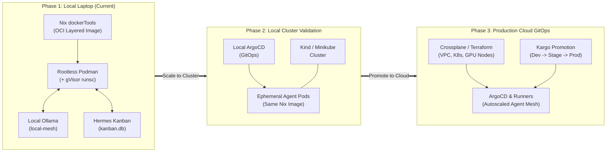

# 🚀 Agent Sandbox & GitOps Kubernetes Roadmap: From Local Laptop to Production

This document establishes the strategic, multi-phase architectural roadmap for deploying and scaling autonomous AI coding agents (**Hermes**, **Claude**, **OpenCode**, **AntiGravity**, **Copilot**) within this repository.

It defines how the **Nix-built Layer 3 Sandbox** transitions seamlessly from **local rootless Podman containers** to a **production-grade GitOps Kubernetes cluster** using **ArgoCD**, **Kargo**, and **Crossplane / Terraform** without Dockerfile drift or security regressions.

---

## 🏛️ The Three Architectural Phases



---

## 📍 Phase 1: Local Laptop Developer Workbench (Current)

### Goal: Zero-Cost, 100% Hermetic, Local Experimentation
- **Container Engine**: Rootless Podman daemon (`systemd --user`).
- **Isolation Boundary**:
  - Process level: Namespaces (PID, Mount, User, Network) + `cgroups`.
  - Syscall level: **gVisor (`runsc`)** user-space kernel (eliminates host Linux kernel sharing).
- **Filesystem**: Only the isolated Git worktree (`.worktrees/<branch>`) is mounted as `/workspace:rw`. Host `/home/tonyh`, host SSH agent, host Tailscale socket, and SOPS age secret keys are completely absent.
- **Guardrails**: Geoffrey Huntley `safeGit` baked directly into `/bin/git` inside the image, physically blocking `git push --force` and branch deletions.
- **Multi-Agent Coordination**: **Hermes Kanban** (`hermes kanban swarm`) with SQLite-backed task tracking and automated verifier/synthesizer loops.
- **Dual Network Modes**:
  - `MODE=local`: Air-gapped, zero external internet; inference routed strictly to local Ollama on `local-mesh`.
  - `MODE=cloud`: Scoped outbound HTTPS permitted for cloud model APIs (Gemini, Anthropic, OpenRouter) with host credentials stripped.

---

## 📍 Phase 2: Local Kubernetes Cluster Validation (Next Milestone)

### Goal: Test GitOps Workflows Locally Without Cloud Spend
- **Local Cluster**: Run **Kind** (Kubernetes in Docker) or **Minikube** on your workstation (both supported via your repository's existing tools).
- **Image Pipeline**:
  - The exact same image built by Nix (`nix build .#agent-sandbox-image`) is loaded directly into the cluster:
    ```bash
    kind load docker-image localhost/agent-sandbox:latest
    ```
- **GitOps Ingress**:
  - Run **ArgoCD** inside the local cluster to manage declarative Kubernetes manifests.
- **Agent Runners as Kubernetes Jobs**:
  - Instead of long-running containers, each agent task runs as a one-shot **Kubernetes Job** mounting a temporary `PersistentVolumeClaim` (PVC) cloned from the repository branch.
  - When the task completes, the pod terminates and its exit status / diff is recorded.

---

## 📍 Phase 3: Production Cloud GitOps Architecture (Future Milestone)

### Goal: Scalable, Multi-Tenant Cloud Agent Infrastructure When Funded
Once cloud credits or funding are available, the architecture scales directly into production:

### 1. Infrastructure as Code (IaC) Layer
- **Crossplane or Terraform**:
  - Declaratively provisions the cloud Kubernetes cluster (e.g. GKE, EKS, or Civo/Hetzner).
  - Provisions GPU node pools (e.g. NVIDIA L4 or A10G) for centralized, fast local model serving (vLLM / Ollama).
  - Provisions isolated VPC networks with egress NAT gateways and iron-proxy firewalls.

### 2. GitOps Delivery Layer (ArgoCD + Kargo)
- **ArgoCD**:
  - Continuously reconciles declarative agent cluster state from Git repositories.
  - Deploys agent runners, ingress proxies, and monitoring infrastructure.
- **Kargo (Multi-Stage Lifecycle Management)**:
  - Manages environment promotions across stages:
    1. **Dev Sandbox**: Ephemeral runner pods executing experimental agent prompts.
    2. **Staging / Verification**: Verifier agents running integration tests and security scans.
    3. **Production Merging**: Synthesizer agents generating and merging pull requests.

### 3. Production Security & Egress Guardrails
- **Kubelet / Container Runtime**: gVisor (`runsc`) configured as the default Kubernetes `RuntimeClass` for all untrusted agent pods.
- **NetworkPolicies**: Strict Kubernetes NetworkPolicies denying all egress except to internal model proxy endpoints and authorized Git remotes.
- **Secrets Management**: External Secrets Operator (ESO) syncing from cloud secret managers (HashiCorp Vault, AWS Secrets Manager, Google Secret Manager), injecting short-lived, rotated tokens directly into container memory.

---

## 🎯 The "Zero Drift" Guarantee

The fundamental advantage of this design is that **Nix is the single source of truth for user space**:

$$\text{Nix Derivation} \xrightarrow{\quad} \text{Local Devenv Shell} \xrightarrow{\quad} \text{Podman Container} \xrightarrow{\quad} \text{Kubernetes Job Pod}$$

1. The exact same `safeGit` patch that prevents accidental force-pushes in your local devenv shell is baked into the OCI container image.
2. The exact same OCI container image that runs on your laptop runs inside the Kubernetes cluster.
3. You never maintain separate `Dockerfile`s that drift out of sync with your Nix development environments.
