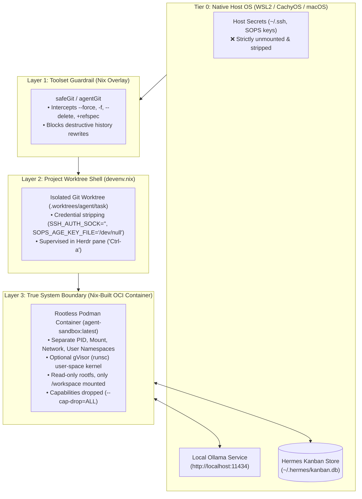
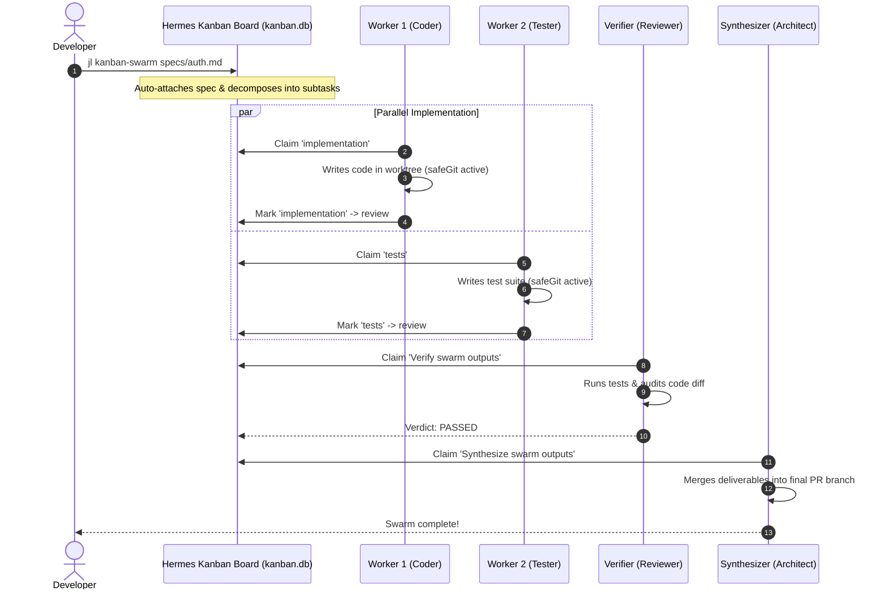

# 🛡️ Autonomous AI Agent Sandboxes & Hermes Kanban Swarms Guide

This guide provides the complete operational and architectural reference for running autonomous AI agents (**Hermes Agent**, **Claude Code**, **OpenCode**, **Google AntiGravity CLI**, **GitHub Copilot**) within **hermetic sandboxes** and orchestrating multi-agent collaboration via **Hermes Kanban Swarms**.

---

## 🏛️ 1. The 3-Layer Sandbox Defense (Geoffrey Huntley Pattern)

Rather than running AI agents directly in your host environment with unrestricted access to your files, SSH keys, and cloud credentials, this repository enforces a **three-layer defense-in-depth model**:



### Layer Comparison

| Layer | Technology | Isolation Level | When to Use |
| :--- | :--- | :--- | :--- |
| **Layer 1** | Nix `safeGit` Overlay | Command-level guardrail | Active everywhere (blocks force-pushes in all environments) |
| **Layer 2** | `devenv` Worktree Shell | Process & credential isolation | Trusted daily pair programming with OpenCode or Claude |
| **Layer 3** | Nix-built Podman + gVisor | System, filesystem & network isolation | Untrusted code execution, autonomous sweeps, multi-agent swarms |

---

## 🚀 2. Launching Isolated Agent Sandboxes

### Layer 2: Worktree Shell Sandboxes (`jl agent-sandbox`)
Creates an isolated Git worktree at `.worktrees/<branch>` with stripped host credentials and spawns the agent inside a dedicated **Herdr pane** (`Ctrl-a`):

```bash
# Launch an agent in an isolated worktree under Herdr supervision
jl agent-sandbox claude
jl agent-sandbox hermes agent/refactor-auth
jl agent-sandbox agy agent/add-feature
jl agent-sandbox opencode agent/fix-bug
```

*(To run standalone in your terminal without Herdr: `cd .worktrees/agent/task && devenv shell -- <agent>`)*.

---

### Layer 3: Containerized System Sandboxes (`jl agent-container`)
Runs the agent inside a **declarative, rootless Podman container** built with Nix (`packages.agent-sandbox-image`):

```bash
# 1. Rebuild and load the container image into Podman (when Nix definitions update)
jl build-agent-image

# 2. Run in Cloud-Egress mode (outbound HTTPS permitted for LLM APIs; host keys stripped)
jl agent-container hermes agent/task cloud

# 3. Run in Strictly-Local Air-Gapped mode (zero public internet; routes only to local Ollama)
jl agent-container hermes agent/private-task local

# 4. Run with gVisor user-space kernel (true VM-grade syscall virtualization)
jl agent-container hermes agent/untrusted-task local gvisor
```

---

## 🔒 3. Dual Network Isolation Modes

| Feature | `MODE="local"` (Strictly Air-Gapped) | `MODE="cloud"` (Hybrid Egress) |
| :--- | :--- | :--- |
| **Public Internet** | ❌ Completely blocked (`--dns=127.0.0.1`) | ✅ Allowed (HTTPS outbound) |
| **Inference Source** | Local Ollama container (`http://local-ollama:11434`) | Cloud APIs (Gemini, Anthropic, OpenRouter) + Local Ollama fallback |
| **Credential Handling** | Zero API keys required | In-memory scoped tokens injected; raw host secret files remain unmounted |
| **Best For** | Offline work, proprietary code, air-gapped tasks | Complex multi-file reasoning requiring frontier cloud models |

---

## 🐝 4. Hermes Kanban Swarms: Multi-Agent Collaboration

Hermes Agent features a native, SQLite-backed task orchestration engine (`hermes kanban`). It allows multiple agent roles to collaborate visibly on a shared task board.



---

### 4.1 Choosing AI Model Profiles for Swarms

Hermes Kanban Swarms route each role (`--worker`, `--verifier`, `--synthesizer`) through a **Hermes profile** stored in `~/.hermes/profiles/<profile>/config.yaml`.

This repository ships ready-to-use sample profile templates under [`dotfiles/hermes/profiles/`](../dotfiles/hermes/profiles/README.md):

| Profile | Backend / Provider | Default Model | Credentials Needed | Best Use Case |
| :--- | :--- | :--- | :--- | :--- |
| **`agy-neon-medium`** *(Default)* | Nous Portal loop + `agy -p` (Gemini 4 Neon Medium) | `stealth/space-bunny-alpha` + `agy` | Nous OAuth + `agy` login (zero API keys) | Default all-rounder, Architect, Synthesizer |
| **`claude-api`** | Direct Anthropic API | `claude-sonnet-4-20250514` | `ANTHROPIC_API_KEY` | High-precision Coder, Verifier / Reviewer |
| **`local-opencode`** | Local Ollama + OpenCode CLI | `qwen2.5-coder:7b` | None (`jl up-llm`) | Offline / private coding worker |
| **`local-ollama`** | Local Ollama (direct) | `qwen2.5-coder:7b` | None (`jl up-llm`) | Air-gapped worker / Container `MODE="local"` |
| **`openrouter-fast`** | OpenRouter | `google/gemini-2.5-flash` | `OPENROUTER_API_KEY` | Fast, low-cost parallel workers |

> [!NOTE]
> **State vs. Config (Prime Directive #3):** Profiles are **seeded** into writable `~/.hermes/profiles/<name>/` directories (never symlinked read-only from `/nix/store`). Keep API keys in `~/.hermes/profiles/<name>/.env` or `~/.bashrc.local`—never commit real tokens to Git.
>
> **Note on `agy-neon-medium`:** Because `agy` is an interactive/print CLI agent rather than a raw HTTP endpoint, `agy-neon-medium` uses **Nous Portal OAuth** (`hermes -p agy-neon-medium auth add nous`, zero API keys required) for Hermes's outer Kanban tool-calling loop and delegates deep reasoning/coding to `agy -p` (which runs on your active Antigravity CLI login, **Gemini 4 Neon Medium**). For a pure native `agy` swarm without Hermes, use `/teamwork` directly inside `agy`.

#### Initializing & Configuring Profiles
```bash
# 1. Seed all sample profiles into ~/.hermes/profiles/ (non-destructive; preserves existing files)
jl kanban-init-profiles

# 2. List installed profiles & available templates
jl kanban-profiles

# 3. Add API keys for cloud profiles (skip this for local-ollama / local-opencode)
cp ~/.hermes/profiles/claude-api/.env.example ~/.hermes/profiles/claude-api/.env
$EDITOR ~/.hermes/profiles/claude-api/.env
```
*(You can also skip step 1—running `jl kanban-swarm` automatically seeds any referenced template profile on first use.)*

---

### 4.2 Dispatching Swarms (String Goal, Spec File & Custom Profiles)

**Syntax:**
```bash
jl kanban-swarm <TARGET> [BOARD="default"] [WORKER="agy-neon-medium"] [VERIFIER] [SYNTHESIZER]
```

* **`TARGET`**: A direct string goal **or** a path to a specification file (Markdown, text, or YAML). If a file path is detected, `kanban-swarm` ingests its contents and physically attaches it to the root task via `hermes kanban attach`.
* **`BOARD`**: Kanban board name (defaults to `default`; auto-created if missing).
* **`WORKER`**: Profile name (defaults to `agy-neon-medium`). Supports bare profile names (`claude-api` → `claude-api:implementation`), explicit `profile:role` (`local-ollama:tests`), or comma-separated multi-worker lists (`"local-opencode:implementation,openrouter-fast:tests"`).
* **`VERIFIER`**: Profile for code review/verification (defaults to the first worker profile).
* **`SYNTHESIZER`**: Profile for final synthesis/merge (defaults to the verifier profile).

#### Examples
```bash
# 1. Default swarm (uses agy-neon-medium for worker, verifier, and synthesizer)
jl kanban-swarm "Implement JWT authentication with unit tests"

# 2. Pass a specification file on a dedicated board (still defaults to agy-neon-medium)
jl kanban-swarm docs/specs/billing.md billing-service

# 3. Run the entire swarm on Claude (via ANTHROPIC_API_KEY)
jl kanban-swarm "Refactor API error handling" default claude-api

# 4. Run 100% locally / offline using OpenCode + Ollama
jl kanban-swarm docs/specs/feature-auth.md default local-opencode

# 5. Hybrid swarm: local/fast workers + Claude verifier + AGY Neon Medium synthesizer
jl kanban-swarm docs/specs/feature-auth.md default local-opencode claude-api agy-neon-medium

# 6. Multi-worker hybrid swarm (parallel implementation + test workers)
jl kanban-swarm docs/specs/feature-auth.md default "local-ollama:implementation,openrouter-fast:tests" claude-api agy-neon-medium
```

---

### 4.3 Inspecting, Triaging & Live Monitoring in Herdr

#### Quick CLI Triage & Management
```bash
# View all tasks on the default board
jl kanban-board

# View tasks on a specific project board
jl kanban-board billing-service

# One-shot triage: list board AND auto-expand failure details for every blocked card
jl kanban-triage
jl kanban-triage billing-service

# Show full details, events, and runs for a specific task
hermes kanban show <task-id>

# Comment on or unblock a paused card
hermes kanban comment <task-id> "Clarification or fix applied"
hermes kanban unblock <task-id>

# Archive completed or test swarm tasks
hermes kanban archive <task-id>
```

#### Unified Live Mission Control in Herdr (`jl herdr-kanban`)
Because `jl kanban-swarm` runs workers as headless background processes, use `jl herdr-kanban` to open a **3-pane live Herdr Mission Control workspace** for any board:

```bash
# Create the 3-pane Mission Control workspace for 'default' (or pass a board name)
jl herdr-kanban
jl herdr-kanban billing-service

# Attach in a dedicated terminal tab (beside tmux)
hc
```

* **Pane 1 (Top-Left)**: Live auto-refreshing Kanban board (`scripts/kanban-watch.sh --watch`) that automatically expands error details for any `⊘ blocked` card.
* **Pane 2 (Bottom-Left)**: Live tail of `~/.hermes/logs/` so you see worker activity and crashes in real time.
* **Pane 3 (Right)**: Plain interactive triage shell ready for `hermes kanban unblock <id>`, `comment`, `git diff`, or ad-hoc `agy` / `claude` / `oc` runs.

*(For a visual browser UI, you can also run `hermes dashboard`.)*

---

## 🌐 5. Bot-to-Bot RPC Mesh (`hermes peer`)

In addition to Kanban swarms, Hermes agents running in separate sandboxes can communicate directly via authenticated HTTP API gateways:

```bash
# 1. Register a peer agent on another container or machine
hermes peer add reviewer --url http://127.0.0.1:8378 --key $REVIEWER_API_KEY

# 2. Send an instant DM to the remote agent
hermes peer dm reviewer "Please review commit 3cadd5f on branch agent/auth"

# 3. Start a long asynchronous task on a peer
hermes peer run reviewer < task-instructions.txt

# 4. Check status of a peer run
hermes peer status reviewer <run-id>
```

---

## 🛣️ 6. Future GitOps & Kubernetes Runway

The OCI container image used locally (`agent-sandbox:latest`) is built directly with Nix (`nix build .#agent-sandbox-image`). Because it does not rely on mutable host paths or Dockerfiles, it translates directly into a production Kubernetes cluster:

- **Local Laptop (Today)**: Run via Rootless Podman + gVisor (`jl agent-container`).
- **Local Kubernetes (Next)**: Run on Minikube / Kind as ephemeral Kubernetes Jobs.
- **Production Cloud (Future)**: Orchestrate fleets of autoscaled agent runners via **ArgoCD + Kargo + Crossplane / Terraform**.

👉 Read the full architectural roadmap in **[`docs/agent-sandbox-k8s-roadmap.md`](agent-sandbox-k8s-roadmap.md)**.
