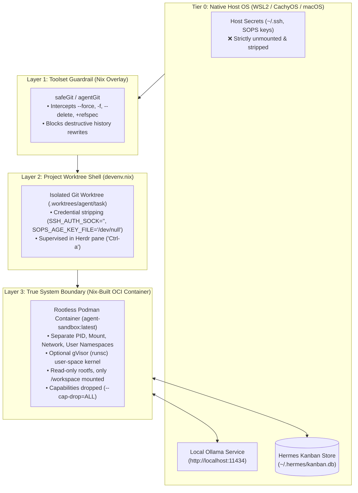
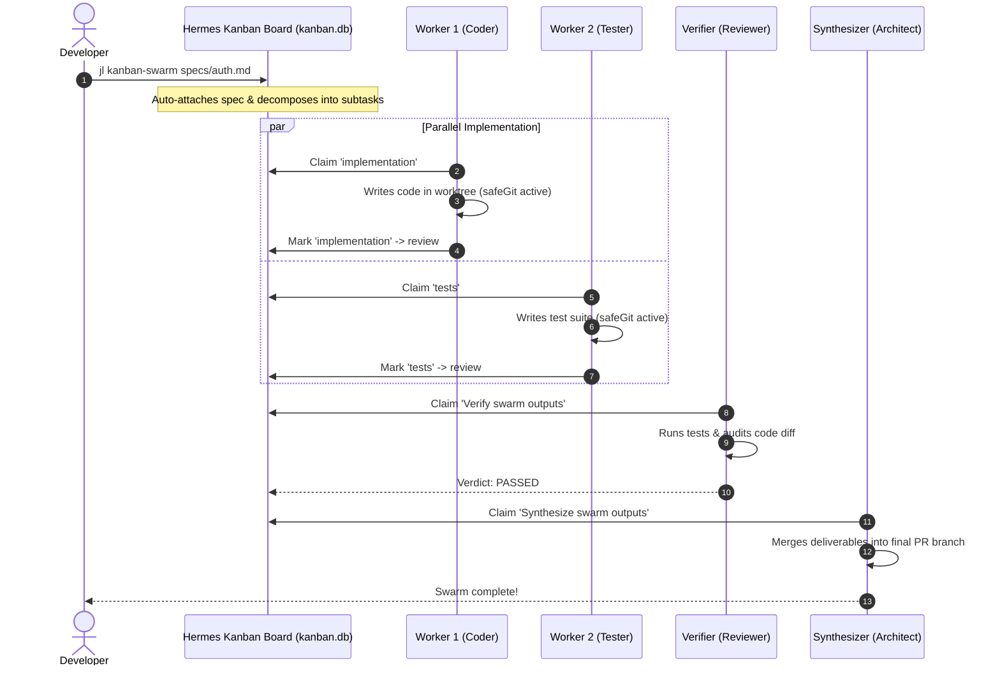

# 🛡️ Autonomous AI Agent Sandboxes & Hermes Kanban Swarms Guide

This guide provides the complete operational and architectural reference for running autonomous AI agents (**Hermes Agent**, **Claude Code**, **OpenCode**, **Google AntiGravity CLI**, **GitHub Copilot**) within **hermetic sandboxes** and orchestrating multi-agent collaboration via **Hermes Kanban Swarms**.

---

## 🏛️ 1. The 3-Layer Sandbox Defense (Geoffrey Huntley Pattern)

Rather than running AI agents directly in your host environment with unrestricted access to your files, SSH keys, and cloud credentials, this repository enforces a **three-layer defense-in-depth model**:



### Layer Comparison

| Layer | Technology | Isolation Level | When to Use |
| :--- | :--- | :--- | :--- |
| **Layer 1** | Nix `safeGit` Overlay | Command-level guardrail | Active everywhere (blocks force-pushes in all environments) |
| **Layer 2** | `devenv` Worktree Shell | Process & credential isolation | Trusted daily pair programming with OpenCode or Claude |
| **Layer 3** | Nix-built Podman + gVisor | System, filesystem & network isolation | Untrusted code execution, autonomous sweeps, multi-agent swarms |

---

## 🚀 2. Launching Isolated Agent Sandboxes

### Layer 2: Worktree Shell Sandboxes (`jl agent-sandbox`)
Creates an isolated Git worktree at `.worktrees/<branch>` with stripped host credentials and spawns the agent inside a dedicated **Herdr pane** (`Ctrl-a`):

```bash
# Launch an agent in an isolated worktree under Herdr supervision
jl agent-sandbox claude
jl agent-sandbox hermes agent/refactor-auth
jl agent-sandbox agy agent/add-feature
jl agent-sandbox opencode agent/fix-bug
```

*(To run standalone in your terminal without Herdr: `cd .worktrees/agent/task && devenv shell -- <agent>`)*.

---

### Layer 3: Containerized System Sandboxes (`jl agent-container`)
Runs the agent inside a **declarative, rootless Podman container** built with Nix (`packages.agent-sandbox-image`):

```bash
# 1. Rebuild and load the container image into Podman (when Nix definitions update)
jl build-agent-image

# 2. Run in Cloud-Egress mode (outbound HTTPS permitted for LLM APIs; host keys stripped)
jl agent-container hermes agent/task cloud

# 3. Run in Strictly-Local Air-Gapped mode (zero public internet; routes only to local Ollama)
jl agent-container hermes agent/private-task local

# 4. Run with gVisor user-space kernel (true VM-grade syscall virtualization)
jl agent-container hermes agent/untrusted-task local gvisor
```

---

## 🔒 3. Dual Network Isolation Modes

| Feature | `MODE="local"` (Strictly Air-Gapped) | `MODE="cloud"` (Hybrid Egress) |
| :--- | :--- | :--- |
| **Public Internet** | ❌ Completely blocked (`--dns=127.0.0.1`) | ✅ Allowed (HTTPS outbound) |
| **Inference Source** | Local Ollama container (`http://local-ollama:11434`) | Cloud APIs (Gemini, Anthropic, OpenRouter) + Local Ollama fallback |
| **Credential Handling** | Zero API keys required | In-memory scoped tokens injected; raw host secret files remain unmounted |
| **Best For** | Offline work, proprietary code, air-gapped tasks | Complex multi-file reasoning requiring frontier cloud models |

---

## 🐝 4. Hermes Kanban Swarms: Multi-Agent Collaboration

Hermes Agent features a native, SQLite-backed task orchestration engine (`hermes kanban`). It allows multiple agent roles to collaborate visibly on a shared task board.



---

### 4.1 Dispatching Swarms (String Goal vs. Specification File)

The `jl kanban-swarm` recipe **auto-detects** whether your input is a string or a file path:

#### A. Passing a Direct String Goal
```bash
jl kanban-swarm "Implement JWT authentication with unit tests"
```

#### B. Passing a Specification File Directly
If you pass a path to a Markdown, text, or YAML file, `kanban-swarm` automatically:
1. Ingests the entire specification into the swarm root task.
2. Physically attaches the file to the task in SQLite via `hermes kanban attach`.
3. Ensures all workers, verifiers, and synthesizers have the complete spec in their prompt context.

```bash
# Pass any spec file directly
jl kanban-swarm docs/specs/feature-auth.md

# Target a dedicated project board (auto-creates if missing)
jl kanban-swarm docs/specs/billing.md billing-service
```

---

### 4.2 Inspecting and Managing the Board

```bash
# View all tasks on the default board
jl kanban-board

# View tasks on a specific project board
jl kanban-board billing-service

# Show full details, events, and runs for a task
hermes kanban show <task-id>

# View attachments on a task
hermes kanban attachments <task-id>

# Archive completed swarm tasks
hermes kanban archive <task-id>
```

---

## 🌐 5. Bot-to-Bot RPC Mesh (`hermes peer`)

In addition to Kanban swarms, Hermes agents running in separate sandboxes can communicate directly via authenticated HTTP API gateways:

```bash
# 1. Register a peer agent on another container or machine
hermes peer add reviewer --url http://127.0.0.1:8378 --key $REVIEWER_API_KEY

# 2. Send an instant DM to the remote agent
hermes peer dm reviewer "Please review commit 3cadd5f on branch agent/auth"

# 3. Start a long asynchronous task on a peer
hermes peer run reviewer < task-instructions.txt

# 4. Check status of a peer run
hermes peer status reviewer <run-id>
```

---

## 🛣️ 6. Future GitOps & Kubernetes Runway

The OCI container image used locally (`agent-sandbox:latest`) is built directly with Nix (`nix build .#agent-sandbox-image`). Because it does not rely on mutable host paths or Dockerfiles, it translates directly into a production Kubernetes cluster:

- **Local Laptop (Today)**: Run via Rootless Podman + gVisor (`jl agent-container`).
- **Local Kubernetes (Next)**: Run on Minikube / Kind as ephemeral Kubernetes Jobs.
- **Production Cloud (Future)**: Orchestrate fleets of autoscaled agent runners via **ArgoCD + Kargo + Crossplane / Terraform**.

👉 Read the full architectural roadmap in **[`docs/agent-sandbox-k8s-roadmap.md`](agent-sandbox-k8s-roadmap.md)**.
