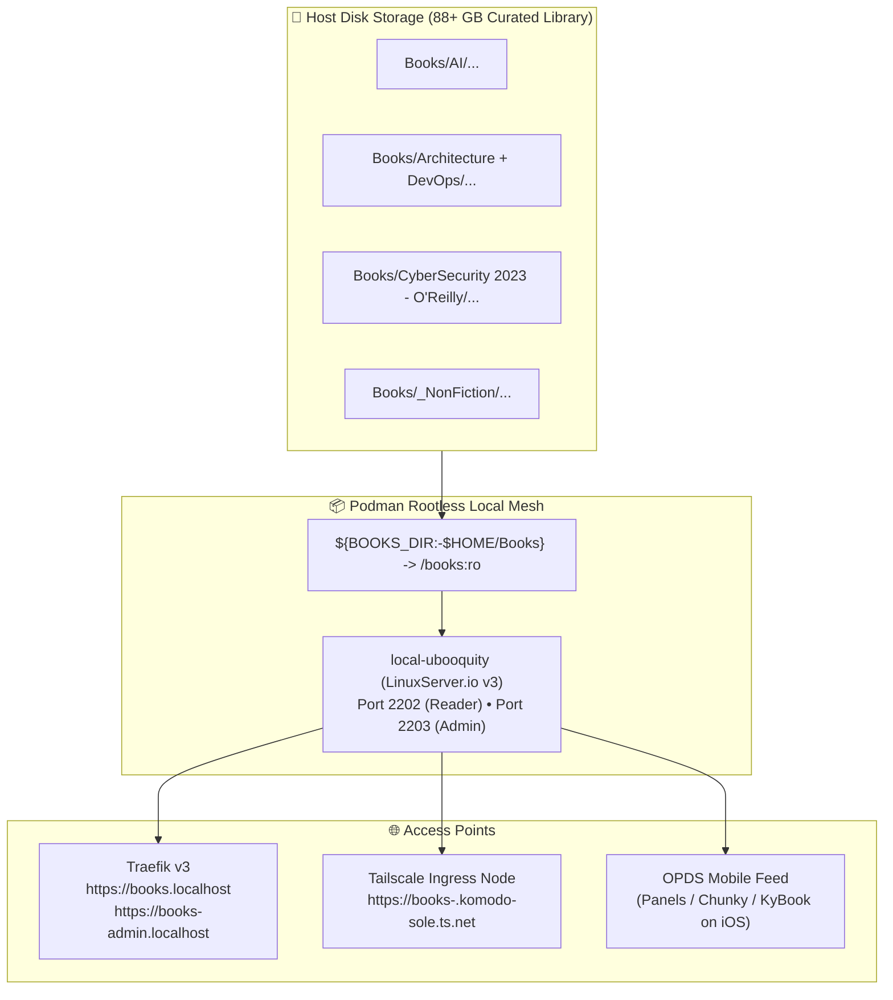

# 📚 Ubooquity 3 Book Server: Architecture, Storage & Multi-Platform Guide

This guide details the architecture, multi-platform storage configuration (Arch/CachyOS Linux, Windows/WSL2, macOS), first-time administration, and remote Tailscale access for the **Ubooquity 3** e-book and comic server.

---

## 🏗️ 1. Architecture & Why Ubooquity 3

Unlike metadata-centric servers (like Kavita or Calibre) that force books into an arbitrary `Author / Series` model, **Ubooquity strictly preserves your underlying folder structure**. 



### Key Advantages:
* **100% Folder Preservation**: Every category, topic, Humble Bundle, and subfolder on your drive appears exactly as arranged in your browser.
* **Zero File Renaming**: 15,900+ files and 8,800+ directories work immediately without re-tagging or restructuring.
* **Unified v3 Engine**: Built-in dark mode web reader for **EPUB, PDF, CBR, and CBZ**, with persistent reading progress tracking.
* **OPDS Support**: Connect native iOS/iPadOS reader apps directly over your encrypted Tailscale mesh.

---

## 🗂️ 2. Multi-Platform Storage Configuration (`BOOKS_DIR`)

The storage mount is dynamically evaluated inside [`local-services/docker-compose.yml`](file:///home/tonyh/_Projects/setup-linux-scripts/local-services/docker-compose.yml):
```yaml
volumes:
  - ubooquity-data:/config
  - "${BOOKS_DIR:-$HOME/Books}:/books:ro"
  - "${BOOKS_DIR_2:-${BOOKS_DIR:-$HOME/Books}}:/books2:ro"
  - "${BOOKS_DIR_3:-${BOOKS_DIR:-$HOME/Books}}:/books3:ro"
  - "${COMICS_DIR:-${BOOKS_DIR:-$HOME/Books}}:/comics:ro"
```

To configure or point to custom or cloud-synced books folders on any machine, add or edit variables inside `local-services/.env` (or `~/.local/share/local-services/.env`). **No git-tracked files need to be modified.**

### Multiple Directories in `local-services/.env`:
If you have multiple disparate libraries across different drives, folders, or cloud sync locations, define them using the numbered variables:

```bash
# In local-services/.env
BOOKS_DIR=/mnt/c/Users/tonyh/OneDrive/Books
BOOKS_DIR_2=/mnt/d/Technical_Archive
BOOKS_DIR_3=/mnt/e/Manuals
COMICS_DIR=/mnt/c/Users/tonyh/OneDrive/Comics
```

* **Inside Ubooquity**: They appear as separate mount targets: `/books`, `/books2`, `/books3`, and `/comics`.
* **In the Admin Console**: Under **Books**, you can click **Add Folder** multiple times to add `/books`, `/books2`, and `/books3`. Each one can have its own friendly display title (e.g., *"Main Library"*, *"Tech Archive"*, *"Manuals"*).

---

### Platform-Specific Single Path Examples:

#### A. Arch / CachyOS Linux (`envy`)
* **Default Path**: `$HOME/Books` (e.g. `/home/thsieh/Books`)
* **Custom / External Drive**:
  ```bash
  # In local-services/.env
  BOOKS_DIR=/mnt/storage/Books
  ```
  *(Or if using OneDrive via rclone / onedrive-abraunegg: `BOOKS_DIR=/home/thsieh/OneDrive/Books`)*

#### B. Windows 11 / WSL2 (`asus`)
In WSL2, Windows host drives are automatically mounted under `/mnt/<drive-letter>/`.
* **OneDrive Books on Windows Host (`C:\Users\tonyh\OneDrive\Books`)**:
  ```bash
  # In local-services/.env
  BOOKS_DIR=/mnt/c/Users/tonyh/OneDrive/Books
  ```
* **Secondary Windows Drive (`D:\Books`)**:
  ```bash
  # In local-services/.env
  BOOKS_DIR=/mnt/d/Books
  ```

#### C. macOS (Darwin)
* **Default Path**: `$HOME/Books` (e.g. `/Users/thsieh/Books`)
* **OneDrive on macOS**:
  ```bash
  # In local-services/.env
  BOOKS_DIR="/Users/thsieh/Library/CloudStorage/OneDrive-Personal/Books"
  ```
* **External USB Drive**:
  ```bash
  # In local-services/.env
  BOOKS_DIR=/Volumes/PortableSSD/Books
  ```

---

## 🚀 3. Quick Start & Service Commands

Manage Ubooquity using the `jl` task runner:

```bash
# Start Ubooquity
jl up-books

# View status
jl status

# Follow container logs
jl logs ubooquity

# Stop Ubooquity
jl down-books
```

---

## ⚙️ 4. First-Time Admin Setup & Library Scanning

Once started, configure Ubooquity via its dedicated admin panel:

1. **Open the Admin Panel**:
   * Navigate to: **`http://localhost:2203/ubooquity/admin`**  
     *(Or locally via Traefik: `https://books-admin.localhost`)*
2. **Set Admin Password**:
   * On first launch, Ubooquity prompts you to create a secure administrator password.
3. **Add Your Books Directory**:
   * In the top navigation bar, click on **Books**.
   * Click **Add Folder** (or **+**).
   * In the path browser, select **`/books`** (this is the container mount of your host `BOOKS_DIR`).
   * Enter a display name (e.g. `Library` or `Books`).
4. **Trigger Initial Scan**:
   * Under the **General** tab, click **Scan Now**.
   * Ubooquity will index your files and build thumbnail covers while keeping your folder hierarchy intact.

---

## 📱 5. Accessing Your Books Remotely

### Method A: Browser Reading (iPhone / iPad / Laptop)
With Tailscale connected:
```text
https://books-<machine>.komodo-sole.ts.net
```
* **Envy**: `https://books-envy.komodo-sole.ts.net`
* **Asus**: `https://books-asus.komodo-sole.ts.net`

### Method B: Native iOS E-Reader Apps via OPDS
Ubooquity provides an OPDS catalog feed compatible with top iOS reading apps (*Panels*, *Chunky Comic Reader*, *KyBook 3*, *Marvin*):
1. In the iOS app, tap **Add OPDS Catalog**.
2. Enter the Catalog URL:
   ```text
   https://books-<machine>.komodo-sole.ts.net/opds
   ```
3. Enter your Ubooquity username and password (if authentication is enabled).
4. You can now browse your exact topic folders and download or stream books directly inside your favorite reading app.
