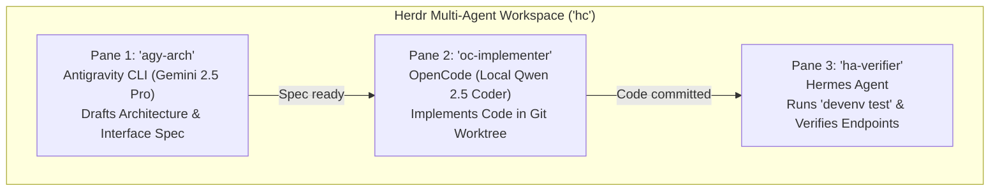

# 🐾 Herdr Agent Multiplexer & Supervisor Guide

This guide details the architecture, setup, multi-model configuration (Google Gemini, Local Ollama, OpenRouter), and workflow patterns for **Herdr** (`herdrdev/herdr`, CLI: `hc`), the open-source agent-aware terminal multiplexer and supervisor runtime.

---

## 🎯 1. What is Herdr? (Executive Overview)

**Herdr** is a native, Rust-based **terminal multiplexer and process supervisor designed specifically for AI coding agents**. 

```
┌────────────────────────────────────────────────────────────────────────┐
│  Herdr ('hc') — Layer 2 Supervisor, Multiplexer & Attention Queue       │
│                                                                        │
│  ┌─────────────────────────┐  ┌──────────────────┐  ┌────────────────┐ │
│  │ Google Antigravity CLI  │  │  OpenCode ('oc') │  │  Hermes ('ha') │ │
│  │      ('agy')            │  │  Pair Programmer │  │   Operator     │ │
│  │   Gemini 2.5 Pro/Flash  │  │  Local / Hosted  │  │  Cron / ReAct  │ │
│  └─────────────────────────┘  └──────────────────┘  └────────────────┘ │
│               ▲                        ▲                    ▲          │
│               └────────────────────────┼────────────────────┘          │
│                                        │                               │
│                         Attention Queue & Inbox                        │
│             [● Working • ⚠️ Needs Approval • ✓ Done • ○ Idle]           │
└────────────────────────────────────────────────────────────────────────┘
```

### Why Herdr Instead of Plain `tmux`?
| Feature | Traditional `tmux` | Herdr (`hc`) |
| :--- | :--- | :--- |
| **Buffer Awareness** | Raw terminal escape sequences & text | **Agent lifecycle states** (`working`, `blocked on input`, `done`, `idle`) |
| **Notification Hub** | Manual cycling through windows (`Ctrl-B n`) | **Unified attention queue / inbox** showing only panes needing human judgment |
| **Inter-Agent Subagents** | Complex bash scripting / send-keys hacks | **Native CLI & socket API** (`hc spawn`, `hc send`, `hc wait`) |
| **Process Resilience** | Tied to tmux server socket | Headless daemon (`herdr-core`) surviving network drops and SSH reconnects |
| **Remote Mobile Access** | Requires terminal client (Termius/SSH) | Native companion support (**Ovis**) over Tailscale (`*.komodo-sole.ts.net`) |

---

## ❓ 2. Core Questions Answered

### Q1: Can I use Google Antigravity CLI (`agy`) with Herdr?
> **YES, absolutely!**

Herdr attaches an interactive pseudo-terminal (PTY) to any CLI process. You can run `agy` directly inside a dedicated Herdr pane:

```bash
# 1. Start an interactive Antigravity CLI session inside Herdr via task runner:
jl herdr-spawn agy

# 2. Or attach directly to the interactive Herdr TUI:
hc
```

**Why pairing Antigravity with Herdr is powerful**:
* **Long-Running Thinking**: When Antigravity executes complex planning, deep codebase surveys, or web verification, you don't need to keep your terminal window open.
* **Non-Blocking Execution**: Herdr runs `agy` in the background. When `agy` generates an artifact or asks for user feedback, Herdr automatically flags the pane in your attention queue (`⚠️ Blocked / Needs Input`).

---

### Q2: Is Herdr only API based?
> **NO. Herdr offers two complementary faces:**

1. **Interactive TUI / Terminal Manager**:
   * Like `tmux` or `zellij`, running `hc` (or `herdr`) attaches to an interactive full-screen terminal interface with tabbed windows, split panes, and mouse/keyboard navigation.
   * Features a global **Attention Inbox** listing every active agent and its status (`idle`, `working`, `blocked`, `done`).
2. **Programmatic CLI & Unix Domain Socket API (`herdr` / `hc`)**:
   * Commands like `jl herdr-spawn`, `herdr agent start`, `herdr agent prompt`, `herdr agent read`, and `herdr agent list` allow you (or autonomous agents like Hermes) to orchestrate child agents via scripts:
     ```bash
     # Programmatically launch an agent pane from a script or another agent:
     jl herdr-spawn opencode
     ```

---

### Q3: What systems & models can it run with? (Local vs. Gemini vs. Hosted)
> **Herdr is model-agnostic.** Because Herdr manages the terminal runtime layer (Layer 2), the choice of AI model is determined by the agent running inside the pane:

#### A. Google Gemini (Cloud Hosted)
* **Antigravity CLI (`agy`)**: Operates natively on Google Gemini models (`gemini-2.5-pro`, `gemini-2.0-flash`).
* **OpenCode (`oc`)**: Set `GEMINI_API_KEY` in `~/.bashrc.local`, then run:
  ```bash
  hc spawn --name "gemini-coder" oc --model gemini-2.5-pro
  ```
* **Hermes Agent (`ha`)**: Configure `~/.hermes/config.yaml` or run:
  ```bash
  hc spawn --name "gemini-hermes" ha --model gemini/gemini-2.0-flash
  ```

#### B. Local Offline Models (Ollama Mesh)
* Ensure your local model service is running (`jl up-llm`).
* **OpenCode (`oc`)**: Connect to local Ollama via OpenAI-compatible endpoint:
  ```bash
  hc spawn --name "local-coder" oc --model qwen2.5-coder:7b
  ```
* **Hermes Agent (`ha`)**: Run offline research:
  ```bash
  hc spawn --name "local-hermes" ha --model ollama/qwen2.5-coder:7b
  ```

#### C. Hybrid Concurrent Orchestration (The Best of Both Worlds)
Herdr allows you to run multiple agents targeting **different backends simultaneously in side-by-side panes**:
* **Pane 1**: Antigravity CLI (`agy`) with **Gemini 2.5 Pro** drafting architecture specs with 1M+ token context.
* **Pane 2**: OpenCode (`oc`) with **local `qwen2.5-coder:7b`** performing fast, private offline refactoring with zero API fees.
* **Pane 3**: Hermes Agent (`ha`) running automated regression tests.

---

## 🚀 3. Installation & Setup

### 3.1 Installing Herdr via `bootstrap.sh`
To install Herdr on any machine (Arch/CachyOS, Ubuntu WSL2, macOS):

```bash
cd ~/setup-linux-scripts
./bootstrap.sh --with-herdr
```

This installs the pre-compiled `herdr-core` / `hc` binary into `~/.local/bin/` (with automatic fallback to `cargo install` if a release binary is unavailable for the host architecture).

### 3.2 Shell Alias (`home/shell.nix`)
The shorthand **`hc`** is automatically registered in your shell:
```bash
hc          # Launches / attaches to the interactive Herdr session
hc --help   # Displays command options
```

### 3.3 Installing Agent Integrations (State Tracking & Lifecycle Hooks)
In Herdr, the **Settings → Integrations** screen inside the TUI is a **read-only status dashboard** showing whether lifecycle hooks are installed. To enable deep state tracking (e.g., detecting when an agent transitions into `working` vs `idle` or `blocked`):

```bash
# Install integration for Google Antigravity CLI:
herdr integration install antigravity-cli

# Install integration for OpenCode:
herdr integration install opencode

# List installed status:
herdr integration list
```

* **How Antigravity State Reporting Works:** Installing `antigravity-cli` registers a lifecycle hook in `~/.gemini/antigravity-cli/` so that whenever `agy` starts a reasoning step, invokes tools, or awaits input, it signals the Herdr API socket to update its state banner to `working` or `blocked`. Without the hook, Herdr passively monitors terminal output, which may only report `idle` or `unknown`.

### 3.4 How to Start an Agent in Herdr (`hc`)
You can launch and supervise an agent using three straightforward methods:

#### Method 1: Directly inside any `hc` Terminal Pane (Interactive)
Every pane in Herdr is a standard shell session:
1. Inside `hc`, navigate to your terminal prompt (`❯`).
2. Simply type the agent command and press **Enter**:
   * `agy` — launches Google Antigravity CLI
   * `opencode` (or `oc`) — launches OpenCode
   * `hermes` (or `ha`) — launches Hermes Agent
3. Herdr immediately detects the process in that pane, attaches the agent badge in the sidebar, and begins tracking its attention lifecycle (`working`, `blocked`, `idle`).

*(Tip: Split a pane first with `Ctrl-a %` or open a new tab with `Ctrl-a c`, then launch the agent in the new pane.)*

#### Method 2: From the UI Sidebar (`+` Menu)
If mouse or trackpad reporting is enabled in your terminal:
* Click the **`+`** icon on the top tab bar or workspace sidebar to spawn a new agent pane directly from the list of recognized agents.

#### Method 3: From Outside `hc` via Task Runner (`jl`)
If you are at your regular terminal prompt (outside of `hc`) and want to spin up an agent in the background before attaching:
```bash
# Spawn Antigravity under Herdr supervision
jl herdr-spawn agy

# Or spawn OpenCode
jl herdr-spawn opencode
```
This automatically provisions an isolated workspace, starts the agent under supervision, and begins attention tracking. When ready, run `hc` to attach directly to it.


---

## 🛠️ 4. Managing Herdr via Task Runner (`jl`)

You can control the Herdr supervisor daemon using our `jl` task runner:

| Command | Action |
| :--- | :--- |
| `jl herdr-up` | Starts the Herdr supervisor daemon in the background |
| `jl herdr-status` | Displays active daemon status and running agent sessions |
| `jl herdr-spawn <agent> [args]` | Spawns an agent into Herdr (e.g. `jl herdr-spawn agy` or `jl herdr-spawn oc`) |
| `jl herdr-down` | Gracefully stops the Herdr supervisor daemon |

---

## 🔄 5. Real-World Multi-Agent Workflows

### Scenario: The Three-Tier Development Pipeline



1. **Step 1: Start Herdr Supervisor Daemon**:
   ```bash
   jl herdr-up
   ```
2. **Step 2: Spawn Antigravity for Architecture Planning**:
   ```bash
   jl herdr-spawn agy
   ```
3. **Step 3: Spawn OpenCode for Offline Coding**:
   ```bash
   jl herdr-spawn opencode
   ```
4. **Step 4: Check Attention Queue & Active Panes**:
   ```bash
   jl herdr-status
   ```
5. **Step 5: Attach Interactively to the Herdr TUI**:
   ```bash
   hc    # (or bare 'herdr')
   ```
   * **Prefix Key**: Configured as `Ctrl-a` in `~/.config/herdr/config.toml` (defaults to `Ctrl-b` in upstream Herdr). Press `Ctrl-a`, release, then press your action key.
   * **Keybindings Reference**:
     * `Ctrl-a d` or `Ctrl-a q` — **Detach** client (leaves all agents & panes running in background).
     * `Ctrl-a ?` — Show **interactive keybindings help overlay**.
     * `Ctrl-a c` — Create a new **tab**.
     * `Ctrl-a %` or `Ctrl-a v` — **Split pane vertically** (side-by-side, tmux style).
     * `Ctrl-a "` or `Ctrl-a -` — **Split pane horizontally** (top/bottom, tmux style).
     * `Ctrl-a h / j / k / l` — **Navigate** between panes (vim direction keys).
     * `Ctrl-a w` — **Workspace / Attention Inbox** switcher.
     * `Ctrl-a z` — **Zoom / maximize** active pane.
   * Herdr notifies you only when an agent finishes or pauses for human confirmation.

---

## 📱 6. Remote Supervision over Tailscale (Ovis Companion)

Because all developer machines in this setup belong to your encrypted Tailnet (`komodo-sole.ts.net`), you can connect a companion web or mobile client (like Ovis) to monitor and approve agent tasks from your iPhone or secondary laptop away from your desk:

* **Tailnet Machine Address**: `https://desktop-envy.komodo-sole.ts.net` or `envy.komodo-sole.ts.net`
* **Agent Sessions**: Kept alive 24/7 by `herdr-core`, even if your laptop sleeps or your connection drops.
