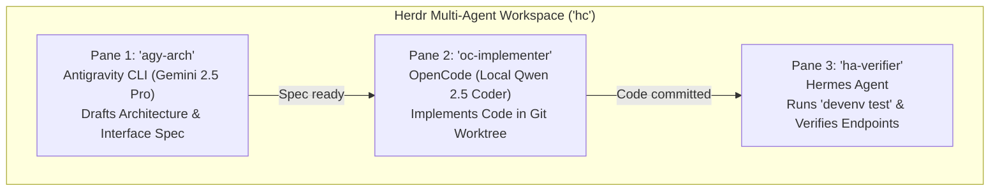

# 🐾 Herdr Agent Multiplexer & Supervisor Guide

This guide details the architecture, setup, multi-model configuration (Google Gemini, Local Ollama, OpenRouter), and workflow patterns for **Herdr** (`herdrdev/herdr`, CLI: `hc`), the open-source agent-aware terminal multiplexer and supervisor runtime.

---

## 🎯 1. What is Herdr? (Executive Overview)

**Herdr** is a native, Rust-based **terminal multiplexer and process supervisor designed specifically for AI coding agents**. 

```
┌────────────────────────────────────────────────────────────────────────┐
│  Herdr ('hc') — Layer 2 Supervisor, Multiplexer & Attention Queue       │
│                                                                        │
│  ┌─────────────────────────┐  ┌──────────────────┐  ┌────────────────┐ │
│  │ Google Antigravity CLI  │  │  OpenCode ('oc') │  │  Hermes ('ha') │ │
│  │      ('agy')            │  │  Pair Programmer │  │   Operator     │ │
│  │   Gemini 2.5 Pro/Flash  │  │  Local / Hosted  │  │  Cron / ReAct  │ │
│  └─────────────────────────┘  └──────────────────┘  └────────────────┘ │
│               ▲                        ▲                    ▲          │
│               └────────────────────────┼────────────────────┘          │
│                                        │                               │
│                         Attention Queue & Inbox                        │
│             [● Working • ⚠️ Needs Approval • ✓ Done • ○ Idle]           │
└────────────────────────────────────────────────────────────────────────┘
```

### Why Herdr Instead of Plain `tmux`?
| Feature | Traditional `tmux` | Herdr (`hc`) |
| :--- | :--- | :--- |
| **Buffer Awareness** | Raw terminal escape sequences & text | **Agent lifecycle states** (`working`, `blocked on input`, `done`, `idle`) |
| **Notification Hub** | Manual cycling through windows (`Ctrl-B n`) | **Unified attention queue / inbox** showing only panes needing human judgment |
| **Inter-Agent Subagents** | Complex bash scripting / send-keys hacks | **Native CLI & socket API** (`hc spawn`, `hc send`, `hc wait`) |
| **Process Resilience** | Tied to tmux server socket | Headless daemon (`herdr-core`) surviving network drops and SSH reconnects |
| **Remote Mobile Access** | Requires terminal client (Termius/SSH) | Native companion support (**Ovis**) over Tailscale (`*.komodo-sole.ts.net`) |

---

## ❓ 2. Core Questions Answered

### Q1: Can I use Google Antigravity CLI (`agy`) with Herdr?
> **YES, absolutely!**

Herdr attaches an interactive pseudo-terminal (PTY) to any CLI process. You can run `agy` directly inside a dedicated Herdr pane:

```bash
# 1. Start an interactive Antigravity CLI session inside Herdr:
hc spawn --name "agy-planner" agy

# 2. Or pass a direct instruction to Antigravity inside Herdr:
hc spawn --name "arch-plan" agy "Analyze our Nix templates and propose a C++ template"
```

**Why pairing Antigravity with Herdr is powerful**:
* **Long-Running Thinking**: When Antigravity executes complex planning, deep codebase surveys, or web verification, you don't need to keep your terminal window open.
* **Non-Blocking Execution**: Herdr runs `agy` in the background. When `agy` generates an artifact or asks for user feedback, Herdr automatically flags the pane in your attention queue (`⚠️ Blocked / Needs Input`).

---

### Q2: Is Herdr only API based?
> **NO. Herdr offers two complementary faces:**

1. **Interactive TUI / Terminal Manager**:
   * Like `tmux` or `zellij`, running `hc` attaches to an interactive full-screen terminal interface with tabbed windows, split panes, and mouse/keyboard navigation.
   * Features a global **Attention Inbox** listing every active agent and its status.
2. **Programmatic CLI & Unix Domain Socket API (`hc`)**:
   * Commands like `hc spawn`, `hc send`, `hc list`, `hc kill`, and `hc wait` allow you (or autonomous agents like Hermes) to orchestrate child agents via scripts:
     ```bash
     # Programmatically launch an agent pane from a script or another agent:
     hc spawn --name "refactor-worker" oc "Refactor src/api.ts to use Effect-TS"
     ```

---

### Q3: What systems & models can it run with? (Local vs. Gemini vs. Hosted)
> **Herdr is model-agnostic.** Because Herdr manages the terminal runtime layer (Layer 2), the choice of AI model is determined by the agent running inside the pane:

#### A. Google Gemini (Cloud Hosted)
* **Antigravity CLI (`agy`)**: Operates natively on Google Gemini models (`gemini-2.5-pro`, `gemini-2.0-flash`).
* **OpenCode (`oc`)**: Set `GEMINI_API_KEY` in `~/.bashrc.local`, then run:
  ```bash
  hc spawn --name "gemini-coder" oc --model gemini-2.5-pro
  ```
* **Hermes Agent (`ha`)**: Configure `~/.hermes/config.yaml` or run:
  ```bash
  hc spawn --name "gemini-hermes" ha --model gemini/gemini-2.0-flash
  ```

#### B. Local Offline Models (Ollama Mesh)
* Ensure your local model service is running (`jl up-llm`).
* **OpenCode (`oc`)**: Connect to local Ollama via OpenAI-compatible endpoint:
  ```bash
  hc spawn --name "local-coder" oc --model qwen2.5-coder:7b
  ```
* **Hermes Agent (`ha`)**: Run offline research:
  ```bash
  hc spawn --name "local-hermes" ha --model ollama/qwen2.5-coder:7b
  ```

#### C. Hybrid Concurrent Orchestration (The Best of Both Worlds)
Herdr allows you to run multiple agents targeting **different backends simultaneously in side-by-side panes**:
* **Pane 1**: Antigravity CLI (`agy`) with **Gemini 2.5 Pro** drafting architecture specs with 1M+ token context.
* **Pane 2**: OpenCode (`oc`) with **local `qwen2.5-coder:7b`** performing fast, private offline refactoring with zero API fees.
* **Pane 3**: Hermes Agent (`ha`) running automated regression tests.

---

## 🚀 3. Installation & Setup

### 3.1 Installing Herdr via `bootstrap.sh`
To install Herdr on any machine (Arch/CachyOS, Ubuntu WSL2, macOS):

```bash
cd ~/setup-linux-scripts
./bootstrap.sh --with-herdr
```

This installs the pre-compiled `herdr-core` / `hc` binary into `~/.local/bin/` (with automatic fallback to `cargo install` if a release binary is unavailable for the host architecture).

### 3.2 Shell Alias (`home/shell.nix`)
The shorthand **`hc`** is automatically registered in your shell:
```bash
hc          # Launches / attaches to the interactive Herdr session
hc --help   # Displays command options
```

---

## 🛠️ 4. Managing Herdr via Task Runner (`jl`)

You can control the Herdr supervisor daemon using our `jl` task runner:

| Command | Action |
| :--- | :--- |
| `jl herdr-up` | Starts the Herdr supervisor daemon in the background |
| `jl herdr-status` | Displays active daemon status and running agent sessions |
| `jl herdr-spawn <agent> [args]` | Spawns an agent into Herdr (e.g. `jl herdr-spawn agy` or `jl herdr-spawn oc`) |
| `jl herdr-down` | Gracefully stops the Herdr supervisor daemon |

---

## 🔄 5. Real-World Multi-Agent Workflows

### Scenario: The Three-Tier Development Pipeline



1. **Step 1: Launch Herdr**:
   ```bash
   jl herdr-up
   ```
2. **Step 2: Spawn Antigravity for Architecture Planning**:
   ```bash
   hc spawn --name "spec-architect" agy "Design the authentication schema for our Go service"
   ```
3. **Step 3: Spawn OpenCode for Offline Implementation**:
   ```bash
   hc spawn --name "code-refactor" oc --model qwen2.5-coder:7b
   ```
4. **Step 4: Supervise via Attention Queue**:
   * Switch into Herdr anytime with `hc`.
   * Herdr notifies you only when an agent finishes or pauses for human confirmation.

---

## 📱 6. Remote Supervision over Tailscale (Ovis Companion)

Because all developer machines in this setup belong to your encrypted Tailnet (`komodo-sole.ts.net`), you can connect a companion web or mobile client (like Ovis) to monitor and approve agent tasks from your iPhone or secondary laptop away from your desk:

* **Tailnet Machine Address**: `https://desktop-envy.komodo-sole.ts.net` or `envy.komodo-sole.ts.net`
* **Agent Sessions**: Kept alive 24/7 by `herdr-core`, even if your laptop sleeps or your connection drops.
