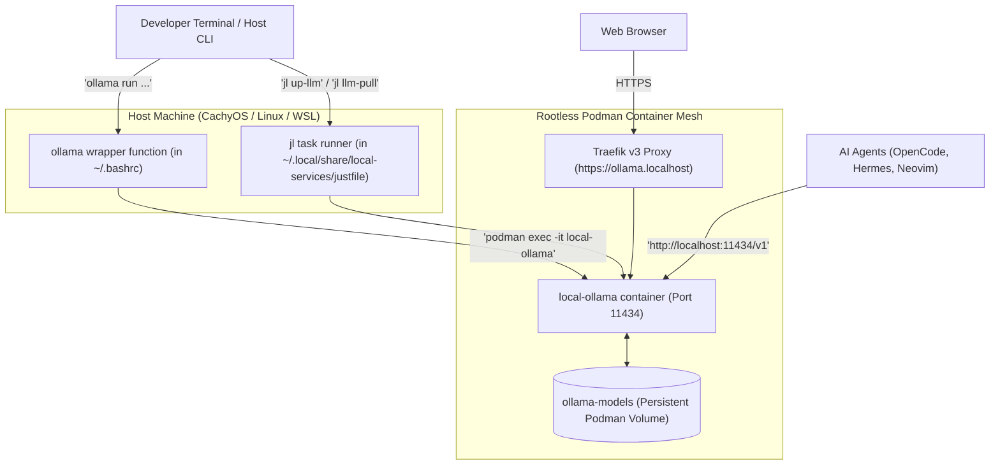

# 🦙 Ollama Local LLM & Rootless Podman Guide

**Runtime**: Rootless Podman & Podman Compose  
**Container**: `local-ollama`  
**Compose Profile**: `profiles: ["llm", "all"]`  
**Host Ports**: `0.0.0.0:11434` (Direct TCP / OpenAI API)  
**Ingress Domain**: `https://ollama.localhost` (Traefik v3 with SSL)  
**Task Runner**: `just` (aliased as `jl`)  

---

## 🏛️ 1. Architecture & Design

Ollama provides private, offline, zero-token-cost Large Language Model inference for coding and agent automation. In this setup, Ollama is containerized within our rootless Podman mesh rather than installed directly as an unmanaged system package.



### Why does `https://ollama.localhost` only say *"Ollama is running"*?
* **Ollama is a headless REST API engine**, not a graphical web application.
* That plain text message (`"Ollama is running"`) is Ollama's official HTTP health-check confirmation indicating that the inference server is online and accepting API calls on port 11434.
* To interact with models visually in a browser, you can attach a web interface like **Open WebUI** (see [Section 7](#7-optional-adding-a-chatgpt-style-web-gui-open-webui)).

---

## ⚡ 2. Quickstart & Service Lifecycle

Ollama runs under the on-demand `llm` profile so it consumes zero CPU or RAM until you explicitly launch it.

### Start and Stop the Service
```bash
# Start Ollama container in the background
jl up-llm

# Check running status and port bindings
jl status

# Stop Ollama container when done (frees all RAM/VRAM)
jl down-llm
```

---

## 💻 3. Command-Line Usage (Host CLI Wrapper)

Because Ollama runs inside a container, a transparent wrapper function is provided in `~/.bashrc`:
```bash
ollama() {
  if [ -t 0 ] && [ -t 1 ]; then
    podman exec -it local-ollama ollama "$@"
  else
    podman exec -i local-ollama ollama "$@"
  fi
}
```

Once your shell is loaded (`exec bash`), you can run `ollama` commands natively on the host:

| Command | Shorthand / Alternative | Description |
| :--- | :--- | :--- |
| `ollama pull <model>` | `jl llm-pull <model>` | Download a model into the container |
| `ollama run <model>` | `jl llm-run <model>` | Launch an interactive chat prompt |
| `ollama list` | `jl llm-list` | List downloaded models on disk |
| `ollama ps` | `podman exec -i local-ollama ollama ps` | View currently loaded models in memory |
| `ollama rm <model>` | `podman exec -i local-ollama ollama rm <model>` | Delete a model to free disk space |
| `jl llm-status` | — | Check API connectivity and model file sizes |

---

## 💬 4. Interactive Terminal Chat Experience

### 1. Pull a Recommended Model
For quick CPU execution, download the lightweight `qwen2.5-coder:1.5b` model (~986 MB):
```bash
ollama pull qwen2.5-coder:1.5b
```

### 2. Start Chatting
```bash
ollama run qwen2.5-coder:1.5b
```

You will enter the interactive REPL:
```text
>>> Write a python function to validate an email address using regex
...
```

### 3. Essential REPL In-Chat Commands
* `/bye` or `Ctrl+D`: Exit the chat session and return to your shell.
* `/clear`: Clear the active conversation context.
* `/show info`: Display active model parameters, context window, and quantization.
* `/?`: Show full help menu for interactive commands.

### 4. One-Shot Piping & Scripting
You can pipe text directly into `ollama` without entering interactive mode:
```bash
# Code review a local file:
cat bootstrap.sh | ollama run qwen2.5-coder:1.5b "Summarize what this bash script does in 3 bullet points"

# Generate git commit messages:
git diff | ollama run qwen2.5-coder:1.5b "Write a conventional git commit message for this diff"
```

---

## 🧠 5. Recommended Models for Coding & Agents

| Model | Parameter Size | Download Size | RAM / VRAM Req. | Best Use Case |
| :--- | :--- | :--- | :--- | :--- |
| **`qwen2.5-coder:1.5b`** | 1.5 Billion | ~986 MB | ~2 GB | Ultra-fast CPU coding, quick bash/python scripts, battery mode |
| **`llama3.2:3b`** | 3.2 Billion | ~2.0 GB | ~3.5 GB | Hermes autonomous agent tasks, summarization, research |
| **`qwen2.5-coder:7b`** | 7.6 Billion | ~4.7 GB | ~6–8 GB | **Daily coding partner**: State-of-the-art coding and tool calling |
| **`qwen2.5-coder:14b`** | 14.7 Billion | ~9.0 GB | ~12–16 GB | High-accuracy refactoring and complex multi-turn logic |
| **`deepseek-coder-v2:lite`** | 16B (MoE) | ~8.9 GB | ~12–16 GB | Mixture-of-Experts coding quality with low active parameter overhead |

To pull any model:
```bash
ollama pull qwen2.5-coder:7b
```

---

## 🤖 6. Connecting AI Agents to Local Ollama

Ollama exposes an **OpenAI-compatible REST API** on:
* Standard HTTP: `http://localhost:11434/v1`
* Trusted HTTPS: `https://ollama.localhost/v1`

### 6.1 Configuring OpenCode (`oc`) for Multiple Ollama Models
OpenCode natively supports connecting to multiple Ollama models simultaneously via `~/.config/opencode/opencode.json`.

#### Option A: Declarative Configuration (`~/.config/opencode/opencode.json`)
You can register multiple local models under the `ollama` provider:
```json
{
  "$schema": "https://opencode.ai/config.json",
  "model": "ollama/qwen2.5-coder:1.5b",
  "provider": {
    "ollama": {
      "npm": "@ai-sdk/openai-compatible",
      "name": "Local Ollama",
      "options": {
        "baseURL": "http://localhost:11434/v1"
      },
      "models": {
        "qwen2.5-coder:1.5b": { "name": "qwen2.5-coder:1.5b" },
        "qwen2.5-coder:7b": { "name": "qwen2.5-coder:7b" },
        "llama3.2:3b": { "name": "llama3.2:3b" },
        "deepseek-coder-v2:lite": { "name": "deepseek-coder-v2:lite" }
      }
    }
  }
}
```

Verify that OpenCode recognizes all configured models:
```bash
opencode models ollama
# Output:
# ollama/deepseek-coder-v2:lite
# ollama/llama3.2:3b
# ollama/qwen2.5-coder:1.5b
# ollama/qwen2.5-coder:7b
```

#### Switching Models in OpenCode:
* **At Launch**: Pass the `--model` flag:
  ```bash
  oc --model ollama/qwen2.5-coder:1.5b
  # or:
  oc --model ollama/qwen2.5-coder:7b
  ```
* **Inside OpenCode (Interactive TUI)**: Type `/model` or use the model switcher UI to swap between models on the fly during a coding session!

#### Connecting to Multiple Ollama Servers (Local + Remote Rig):
You can also connect to multiple separate Ollama server instances (e.g. your local laptop mesh + a secondary GPU homelab server) by declaring separate provider keys:
```json
{
  "provider": {
    "ollama": {
      "npm": "@ai-sdk/openai-compatible",
      "name": "Local Ollama (Laptop)",
      "options": { "baseURL": "http://localhost:11434/v1" },
      "models": { "qwen2.5-coder:1.5b": { "name": "qwen2.5-coder:1.5b" } }
    },
    "ollama-rig": {
      "npm": "@ai-sdk/openai-compatible",
      "name": "Homelab GPU Rig",
      "options": { "baseURL": "http://192.168.1.100:11434/v1" },
      "models": { "qwen2.5-coder:32b": { "name": "qwen2.5-coder:32b" } }
    }
  }
}
```
OpenCode will expose both as `ollama/qwen2.5-coder:1.5b` and `ollama-rig/qwen2.5-coder:32b`.

### 6.2 Configuring Hermes Agent (`ha`)
Hermes Agent uses LiteLLM provider notation. You can configure it via `~/.hermes/config.yaml`:
```yaml
model: "ollama/qwen2.5-coder:7b"
api_base: "http://localhost:11434"
```

### 6.3 Direct REST API & `curl` Examples
Verify API connectivity directly from your terminal:

```bash
# List available models via REST API:
curl -s http://localhost:11434/api/tags | jq .

# Send a chat completion request (OpenAI-compatible format):
curl -s http://localhost:11434/v1/chat/completions \
  -H "Content-Type: application/json" \
  -d '{
    "model": "qwen2.5-coder:1.5b",
    "messages": [
      {"role": "user", "content": "Explain what a Nix Flake is in one sentence."}
    ],
    "temperature": 0.2
  }' | jq '.choices[0].message.content'
```

---

## 🌐 7. Using the ChatGPT-Style Browser UI (Open WebUI)

Open WebUI is integrated directly into the container mesh to provide a complete browser-based chat experience connected directly to Ollama.

### Features
* **Browser Access**: Available over trusted local HTTPS at [https://chat.localhost](https://chat.localhost).
* **Direct Ollama Integration**: Automatically discovers all models downloaded via `ollama pull` (`qwen2.5-coder`, `llama3.2`, etc.).
* **Conversation History & Dark Mode**: Retains past chat sessions in a dedicated persistent volume (`open-webui-data`).
* **Document & PDF Q&A**: Upload local PDF/text files to perform Retrieval-Augmented Generation (RAG) using your local models.
* **Hybrid Cloud Support**: You can optionally paste your Google Gemini or OpenAI API keys in the WebUI settings to chat with both local and cloud models in one place.

### Lifecycle Management
```bash
# Launch Open WebUI (automatically starts Ollama if not already running):
jl up-webui

# Open in your browser:
# https://chat.localhost

# Stop Open WebUI when done:
jl down-webui
```


---

## 🧹 8. Data Storage & Maintenance

* **Model Storage Location**: Models are stored persistently in the rootless Podman named volume `local-services_ollama-models`.
* **Inspect Storage**:
  ```bash
  podman volume inspect local-services_ollama-models
  ```
* **Reclaim Disk Space**:
  ```bash
  # Delete a specific model
  ollama rm qwen2.5-coder:7b

  # Check total container disk usage
  podman system df
  ```
