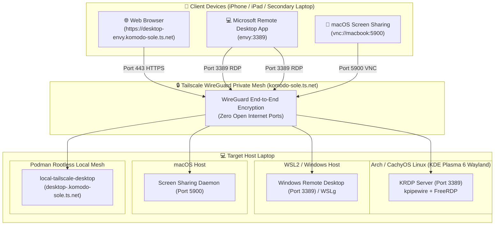

# 🖥️ Remote Desktop: Native RDP & Web Gateway Architecture

This guide details the architecture, setup, multi-platform operation (Arch/CachyOS Linux, WSL2, and macOS), and access modes for **Remote Desktop Access** over your private Tailscale mesh.

It provides two complementary connection modes:
1. 🚀 **Native High-Performance RDP / Screen Sharing**: Connect using native client apps (like **Microsoft Remote Desktop** on iOS/iPadOS, Mac, and Windows) with native display scaling, low latency, and full keyboard/touch support.
2. 🌐 **Dedicated Web Gateway (`https://desktop-<machine>.komodo-sole.ts.net`)**: Connect directly through any modern web browser on standard **HTTPS Port 443** with automatic Port 80 HTTP 301 redirection—without installing any client apps.

---

## 🏗️ Architecture & Security Model



---

## 🖥️ Cross-Platform Implementation Matrix

| Platform | Display Server / Desktop | Remote Desktop Engine | Native Port | Tailnet Ingress Target |
| :--- | :--- | :--- | :--- | :--- |
| **Arch / CachyOS Linux** | Wayland (KDE Plasma 6) | **`krdp`** (Plasma Wayland RDP server) | `3389` (TCP) | `<machine>:3389` or `desktop-<machine>.ts.net` |
| **WSL2 (Windows 11)** | WSLg / Windows Desktop | Windows Remote Desktop / WSLg | `3389` (TCP) | `<machine>:3389` or `<machine>-wsl:3389` |
| **macOS (Darwin)** | Quartz Compositor / macOS | **Screen Sharing** (Apple VNC) | `5900` (TCP) | `vnc://<machine>:5900` |

---

## 🚀 Activation & Management

All remote desktop tasks are integrated into `local-services/justfile` (`jl`):

### 1. Enable Remote Desktop
```bash
jl up-desktop
```
#### What this does automatically:
* **Arch / CachyOS**:
  1. Installs `krdp` via `pacman` if not already present.
  2. Authorizes `org.kde.krdpserver` in the XDG Desktop Portal permission database.
  3. Generates a 10-year encrypted SSL certificate/key in `~/.local/share/krdpserver/`.
  4. Configures `krdpserverrc` via `kwriteconfig6`.
  5. Enables and starts the user systemd service (`systemctl --user enable --now app-org.kde.krdpserver.service`).
* **macOS**: Enables macOS Screen Sharing on port 5900.
* **WSL2**: Displays Windows Remote Desktop and WSLg configuration status.

### 2. Check Remote Desktop Status
```bash
jl status-desktop
```
Displays:
* Listening status on port 3389 (Linux/WSL) or port 5900 (macOS)
* Tailscale host IP and MagicDNS addresses
* Ready-to-use connection strings for iPhone, iPad, Mac, and Windows

### 3. Disable Remote Desktop
```bash
jl down-desktop
```
Stops the desktop server services on the host.

---

## 📱 How to Connect

### Method A: Microsoft Remote Desktop App (Recommended for iPad / iPhone / Mac)

1. Ensure **Tailscale** is connected on your client device.
2. Open the **Microsoft Remote Desktop** app (available free on the iOS/iPadOS App Store and macOS App Store).
3. Tap **+** ➔ **Add PC**.
4. Configure connection:
   * **PC Name**: `envy:3389` (or `envy.komodo-sole.ts.net:3389` or `100.126.45.31:3389`).
   * **User Account**: `thsieh` (and your host account password).
   * **Friendly Name**: `Envy Laptop`.
5. Connect! You now have a full-screen, hardware-accelerated remote desktop session.

### Method B: Dedicated Web Browser Access
Open your web browser (Safari, Chrome, Firefox) to:
```text
https://desktop-envy.komodo-sole.ts.net
```
* **Port 80 Fallback**: Typing `http://desktop-envy.komodo-sole.ts.net` automatically issues an `HTTP 301 Moved Permanently` redirect to HTTPS.
* **TLS Certificate**: Handled automatically via official Let's Encrypt certificates issued to the `tailscale-desktop` sidecar.

---

## 🔒 Security & Best Practices

1. **Zero Open Internet Ports**: All traffic travels strictly through your encrypted Tailscale WireGuard mesh (`100.x.y.z`). Your router does NOT need port 3389 or port 5900 forwarded.
2. **Wayland Session Requirement (Arch/CachyOS)**:
   * `krdp` is a Wayland session stream server. You must be logged into a desktop session for KRDP to capture the screen.
   * If you reboot the laptop remotely and need it to be accessible unattended:
     * Enable **Automatic Login** in **KDE System Settings ➔ Colors & Themes ➔ Login Screen (SDDM) ➔ Behavior ➔ Automatically log in**.
3. **Dedicated RDP Users vs. System Users**:
   * While Linux system users can authenticate, creating a dedicated Remote Desktop account via **KDE System Settings ➔ Remote Desktop ➔ Allowed Users (`+ Add New...`)** is strongly recommended. Dedicated users authenticate directly via FreeRDP internal crypto, preventing any Linux PAM account lockouts (`pam_faillock`).

---

## 🛠️ Technical Incident Analysis & Root Cause Resolutions

During deployment across Arch/CachyOS and Windows/WSL2, several subtle edge cases were identified and systematically resolved:

### 1. KDE Plasma 6 "Automatic Certificate Generation" Bug
* **Symptom**: Toggling the RDP server yielded:
  ```text
  Error message from the RDP server:
  A valid TLS certificate ("") and key ("") is required for the server to run!
  ```
* **Root Cause**: When the GUI's *Generate certificates: Automatically* checkbox is enabled, Plasma 6 leaves `Certificate` and `CertificateKey` empty in `~/.config/krdpserverrc`. The server rejects empty string paths.
* **Resolution**:
  Pre-generate a 10-year self-signed SSL key/cert in `~/.local/share/krdpserver/`, write explicit paths into `~/.config/krdpserverrc`, and disable automatic generation:
  ```bash
  kwriteconfig6 --file krdpserverrc --group General --key Certificate "$HOME/.local/share/krdpserver/krdp.crt"
  kwriteconfig6 --file krdpserverrc --group General --key CertificateKey "$HOME/.local/share/krdpserver/krdp.key"
  kwriteconfig6 --file krdpserverrc --group General --key GenerateCertificate false
  ```
  This is fully automated inside `jl up-desktop` (`scripts/setup-remote-desktop.sh`).

### 2. PAM `unix_chkpwd` Failure via `NoNewPrivileges=true`
* **Symptom**: Connecting from Windows Remote Desktop connected for a few moments, showed a black screen, and immediately dropped with:
  ```text
  krdpserver: pam_unix(login:auth): authentication failure; user=thsieh
  krdpserver: pam_faillock(login:auth): Consecutive login failures for user thsieh account temporarily locked
  krdpserver: ERRCONNECT_CONNECT_TRANSPORT_FAILED [0x0002000D]
  ```
* **Root Cause**: KDE Plasma systemd user services default to `NoNewPrivileges=true`. When `krdpserver` invoked PAM's setuid helper (`unix_chkpwd`) to verify the user's password against `/etc/shadow`, the kernel stripped setuid permissions. Authentication failed despite typing the correct password, triggering Linux `faillock`.
* **Resolution**:
  Configured a systemd user drop-in override (`~/.config/systemd/user/app-org.kde.krdpserver.service.d/override.conf`):
  ```ini
  [Service]
  NoNewPrivileges=false
  ```
  If locked out temporarily by `faillock`, unlock with `sudo faillock --user <username> --reset`.

### 3. Windows Host vs. WSL2 MagicDNS Routing
* **Symptom**: Windows native Remote Desktop Connection (`mstsc.exe`) reported that it could not resolve `envy.komodo-sole.ts.net`.
* **Root Cause**: `mstsc.exe` runs on the Windows host OS, not inside WSL2. When Tailscale is only run inside the WSL2 Linux guest, the Windows host network stack has no Tailscale virtual adapter and cannot route `100.x.y.z` or resolve `.ts.net` MagicDNS.
* **Resolution**:
  * Install **Tailscale for Windows** on the Windows host, placing the entire PC on the WireGuard mesh.
  * Alternatively, connect directly using the target machine's Tailscale IP: `100.126.45.31:3389`.

