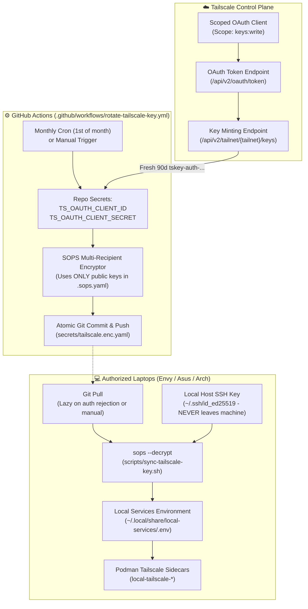

# 🔄 Tailscale Auth Key Rotator Guide (OAuth + Multi-Recipient SOPS)

This guide documents the automated, zero-touch **Tailscale Auth Key Rotator** architecture implemented in `setup-linux-scripts`. It keeps your containerized Tailscale ingress sidecars perpetually authenticated without manual intervention, eliminating the 90-day key expiration barrier.

> [!NOTE]
> **Architectural Reference**: Inspired by [How I Built a Tailscale Auth Key Rotator by Brent Gruber](https://medium.com/@brent.gruber77/how-i-built-a-tailscale-auth-key-rotator-814722b839e0).

---

## 🎯 1. The Problem with Static Tailscale Auth Keys

When deploying containerized or headless Tailscale nodes (such as our dedicated Port 443 ingress sidecars for BentoPDF, Open WebUI, Ollama, Kavita, and Traefik):

1. **Strict 90-Day Lifespan**: Tailscale reusable auth keys have a hard maximum expiration window of **90 days**. When an auth key expires, any container recreate or machine re-provisioning silently fails with authentication errors.
2. **Personal API Keys Are Over-Privileged**: Using personal API tokens carries excessive security risks because they grant full administrative access across your entire Tailnet.
3. **The "Secret Zero" Distribution Dilemma**: Distributing a shared secret across multiple laptops usually requires third-party SaaS platforms (Doppler, 1Password, Vault), creating external vendor dependencies and recurring fees.

---

## 🏛️ 2. Architectural Overview: GitOps + Multi-Recipient Encryption

Our solution combines **Tailscale Scoped OAuth**, **Serverless GitHub Actions**, and **Multi-Recipient SOPS with Host SSH Keys**:



### Key Security & Operational Highlights:

* **Zero Plaintext on Disk (In-Memory Decryption)**: Plaintext tokens are never stored on your laptop's filesystem. `jl up-remote` ephemerally decrypts `TS_AUTHKEY` into memory via SOPS for the few seconds needed to initialize container registration, and unsets it immediately after. `~/.local/share/local-services/.env` stores only non-sensitive configuration (`TS_MACHINE_ID`).
* **Zero Private Keys in Transit**: SOPS encrypts using only **public keys** (`ssh-ed25519` and `age`). No private keys ever leave your workstations or touch GitHub.
* **Serverless Rotation**: A GitHub Actions workflow runs once a month on a schedule, mints a fresh 90-day reusable key via scoped OAuth, re-encrypts `secrets/tailscale.enc.yaml`, and pushes to `main`.
* **Lazy On-Demand Fallback**: Remote laptops don't need continuous background daemons. Once registered, Tailscale caches its node identity in the persistent container volume (`/var/lib/tailscale`) and rarely needs the token again. If bringing up fresh or wiped nodes, `jl up-remote` fetches the latest encrypted key on the fly.

---

## 🚀 3. One-Time Setup Instructions

### Step 1: Create a Scoped OAuth Client in Tailscale

1. Open the [Tailscale OAuth Clients Console](https://login.tailscale.com/admin/settings/oauth).
2. Click **Generate OAuth Client...**.
3. Under **Scopes**, select only **`keys:write`** (Devices: Write Keys).
4. Copy the generated credentials:
   * **Client ID**: starts with `k...`
   * **Client Secret**: starts with `tskey-client-...`

### Step 2: Add Secrets to your GitHub Repository

1. Open your private repository on GitHub.
2. Go to **Settings** $\rightarrow$ **Secrets and variables** $\rightarrow$ **Actions**.
3. Click **New repository secret** and add:
   * `TS_OAUTH_CLIENT_ID`: `<your-tailscale-client-id>`
   * `TS_OAUTH_CLIENT_SECRET`: `<your-tailscale-client-secret>`

### Step 3: Trigger the First Automated Key Rotation

1. In GitHub, navigate to the **Actions** tab.
2. Select the workflow **Rotate Tailscale Auth Key** in the left sidebar.
3. Click **Run workflow** $\rightarrow$ **Run workflow**.
4. The workflow will run in ~10 seconds:
   * It exchanges the credentials for an ephemeral bearer token.
   * Mints a fresh 90-day reusable Tailscale auth key.
   * Encrypts the payload with SOPS for all authorized devices in [`.sops.yaml`](../.sops.yaml).
   * Commits `secrets/tailscale.enc.yaml` to `main`.

---

## 🛠️ 4. Day-to-Day Operations & Tasks

All operations are automated through the `jl` task runner:

### 1. Start Services with In-Memory Secret Injection (`jl up-remote`)
When you run `jl up-remote`, it ephemerally decrypts `TS_AUTHKEY` from `secrets/tailscale.enc.yaml` into RAM, passes it to the container mesh, and unsets it immediately:
```bash
jl up-remote
```
Zero plaintext tokens are written to disk. Once registered, the nodes persist their machine identity in `/var/lib/tailscale`.

### 2. Verify Decryption & Sanitize Local Disk (`jl sync-auth-key`)
To verify that your host SSH key can decrypt secrets and ensure no stale tokens are sitting in your local `.env`:
```bash
jl sync-auth-key
```

### 3. Manual On-Demand Key Rotation (`jl rotate-auth-key`)
If you have `TS_OAUTH_CLIENT_ID` and `TS_OAUTH_CLIENT_SECRET` exported in your local `~/.bashrc.local`, you can rotate keys directly from your terminal:
```bash
jl rotate-auth-key --commit
git push origin main
```

---

## ➕ 5. Adding a New Machine to `.sops.yaml`

When onboarding a new laptop (e.g. `AsusGA403u` or a new secondary machine):

1. **Obtain the machine's public SSH key**:
   ```bash
   cat ~/.ssh/id_ed25519.pub
   # Example: ssh-ed25519 AAAAC3NzaC1l... user@machine
   ```

2. **Add the public key to [`.sops.yaml`](../.sops.yaml)**:
   ```yaml
   creation_rules:
     - path_regex: secrets/.*\.enc\.ya?ml$
       age: >-
         age1k5z7amtmz0s6lr2388x5zcqfw3vypu3uk7v4rcuhlu4mlnk8a4uqjr6x07,
         ssh-ed25519 AAAAC3NzaC1lZDI1NTE5AAAAID/lNe5zgM/4RupoOVTw38BAtWvBOmt+RUvhDFnH2J5o,
         ssh-ed25519 AAAAC3NzaC1lZDI1NTE5AAAAI... user@new-laptop
   ```

3. **Re-encrypt existing secrets for the new recipient**:
   ```bash
   sops updatekeys secrets/tailscale.enc.yaml
   git commit -am "chore(secrets): add new-laptop SSH key to SOPS recipients"
   git push origin main
   ```

Now the new laptop can immediately decrypt `secrets/tailscale.enc.yaml` during `./bootstrap.sh` using its own local private SSH key!

---

## ❓ Frequently Asked Questions

### Q: What if a laptop has been offline or turned off for more than 90 days?
Since GitHub Actions rotates the key on the 1st of every month in the repository, whenever the laptop is turned back on:
1. Run `git pull`.
2. Run `jl sync-auth-key` (or simply `jl up-remote`).
Your machine immediately decrypts the latest valid key and connects.

### Q: Why not use Doppler, HashiCorp Vault, or 1Password Connect?
SaaS secret managers introduce monthly costs, closed-source dependencies, and external network failure points. Storing SOPS-encrypted secrets directly in your private Git repository guarantees 100% data ownership, cryptographic privacy, offline resilience, and zero vendor lock-in.

### Q: Can GitHub Actions see my decrypted secrets?
No. GitHub Actions only holds the scoped OAuth Client credentials (`keys:write`). It mints a *new* auth key via API and uses your *public* keys in `.sops.yaml` to encrypt it into ciphertext before committing. GitHub never has access to the private SSH keys required to decrypt the payload.

### Q: Does this workflow also renew my TLS/HTTPS certificates?
No, because Tailscale handles TLS certificates automatically!
- **Auth Key (`tskey-auth-...`)**: Rotated monthly by GitHub Actions to grant containers permission to register on your Tailnet.
- **TLS Certificates (`*.ts.net`)**: Once registered, each sidecar container's `tailscaled` daemon automatically requests and renews its public Let's Encrypt certificate via ACME every 60 days in the background. All endpoints also bind Port 80 with an automatic HTTP 301 redirect to HTTPS. Zero manual maintenance is required for either layer!
