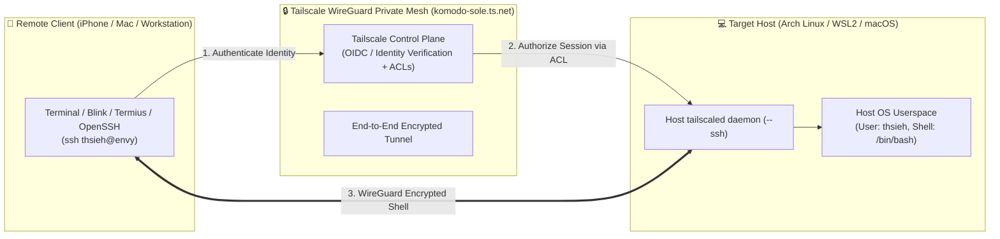
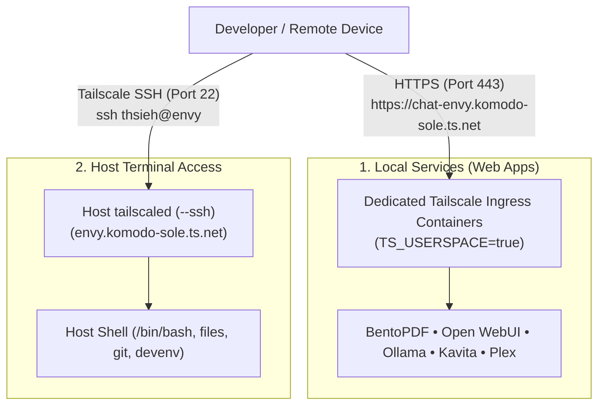

# 🔒 Tailscale SSH: Zero-Trust Remote Terminal Access

This guide details the architecture, setup, cross-platform support (Arch/CachyOS, WSL2, and macOS), and access control policies for **Tailscale SSH**.

Tailscale SSH enables secure, encrypted terminal access to your development machines from your iPhone, iPad, Mac, or secondary laptop from anywhere in the world—**without opening port 22 to the internet, configuring dynamic DNS, managing SSH keys, or risking credential leaks**.

---

## 🏗️ Architecture & Security Model



### Why Tailscale SSH vs. Traditional SSH?

| Capability | Traditional OpenSSH | Tailscale SSH |
| :--- | :--- | :--- |
| **Network Exposure** | Requires open public port (`22`) or port forwarding | **Zero public ports**; communicates purely via WireGuard mesh |
| **Authentication** | Password or static private/public keys on disk | **Identity-based** (Tailscale account, WebAuthn/2FA) |
| **Key Distribution** | Must copy `id_ed25519.pub` to `authorized_keys` on each host | **Zero keys required**; managed entirely by control plane |
| **Key Rotation** | Manual, vulnerable to lost or leaked laptop keys | Automatic via Tailscale OIDC session expiry |
| **Access Control (ACLs)** | Local `sshd_config` or firewall rules | Centralized JSON policy in Tailscale admin console |
| **Rootless vs Host** | N/A | Dedicated host daemon with granular user mapping |

---

## 🌐 Ingress Separation: Web Apps vs. Host SSH

Our infrastructure maintains a strict separation of concerns between web services and host terminal access:



* **Web Services**: Run inside rootless Podman containers with dedicated sidecars (`pdf-<machine>`, `chat-<machine>`, `plex-<machine>`). They never have root access or access to your host shell.
* **Tailscale SSH**: Runs on the host OS daemon (`tailscaled`), giving you terminal access directly to your development environment, files, and project repositories.

---

## 🖥️ Cross-Platform Implementation Matrix

Tailscale SSH is fully supported across all three developer environments targeted by this repository:

| Platform | Host Daemon Setup | Target Hostname | Notes |
| :--- | :--- | :--- | :--- |
| **Arch / CachyOS Linux** | `sudo pacman -S tailscale`<br>`sudo systemctl enable --now tailscaled` | `<machine>` (e.g. `envy`, `asus`) | Full systemd integration; native kernel WireGuard |
| **WSL2 (Ubuntu/Debian)** | `curl -fsSL https://tailscale.com/install.sh \| sh`<br>`sudo systemctl enable --now tailscaled` | `<machine>-wsl` (e.g. `envy-wsl`, `wsl`) | Drops directly into WSL2 Linux shell without Windows port forwarding |
| **macOS (Darwin)** | `brew install tailscale`<br>`sudo tailscaled install-system-daemon` | `<machine>-mac` (e.g. `macbook-mac`) | Requires "Remote Login" enabled in macOS System Settings |

---

## 🚀 Activation & Management

All host Tailscale SSH operations are wrapped in task runner commands (`local-services/justfile` / `jl`):

### 1. Enable Tailscale SSH
```bash
jl up-ssh
```
#### What this does automatically:
1. Detects your platform (Arch, WSL2, or macOS).
2. Installs `tailscale` via the native package manager if missing.
3. Enables and starts the `tailscaled` service.
4. Ephemerally decrypts your Tailscale auth key from `secrets/tailscale.enc.yaml` via SOPS and your host SSH key (zero plaintext written to disk).
5. Brings up the node with `--ssh`, `--hostname=<machine>`, and `--accept-routes`.
6. Prints your MagicDNS address and connection commands.

### 2. Check Tailscale SSH Status
```bash
jl status-ssh
```
Displays:
* Active host name and MagicDNS address (`<machine>.komodo-sole.ts.net`)
* Tailscale IPv4 address
* Tailscale SSH active listener confirmation

### 3. Disable Tailscale SSH
```bash
jl down-ssh
```
Disables the Tailscale SSH listener on the host without disconnecting the Tailnet.

---

## 🔒 Tailnet Access Control Policy (ACLs)

By default, Tailscale requires explicit permission in your Tailnet ACL policy to allow SSH connections.

1. Navigate to the [Tailscale ACL Admin Console](https://login.tailscale.com/admin/acls).
2. Add or update the `"ssh"` block in your ACL JSON policy:

```json
{
  // Allow authenticated Tailnet members to SSH into tagged hosts and own devices
  "ssh": [
    {
      "action": "accept",
      "src": [
        "autogroup:member"
      ],
      "dst": [
        "tag:local-services",
        "autogroup:self"
      ],
      "users": [
        "autogroup:nonroot",
        "root"
      ]
    }
  ]
}
```

> [!TIP]
> Setting `"action": "accept"` allows authorized devices to connect immediately using their Tailscale identity without requiring periodic browser re-authentication checks. If you prefer multi-factor re-prompting every 12 hours, change `"action"` to `"check"`.

---

## 📱 Connecting From Remote Devices

Once `jl up-ssh` has run and your ACL policy includes the `ssh` block, you can connect from any device signed into your Tailnet:

### From macOS or Secondary Linux Laptop:
```bash
ssh thsieh@envy
# or using full MagicDNS:
ssh thsieh@envy.komodo-sole.ts.net
```

### From iPhone or iPad:
1. Install **Tailscale** from the App Store and sign in.
2. Open your preferred terminal app:
   * **Termius**
   * **Blink Shell**
   * **Prompt 3** (Panic)
3. Connect with:
   * **Host**: `envy` (or `envy.komodo-sole.ts.net`)
   * **Username**: `thsieh`
   * **Authentication**: None required (Tailscale handles encryption and identity verification seamlessly).

---

## 🛠️ Troubleshooting

### 1. `Permission denied (tailscale SSH)`
* **Cause**: Your Tailnet ACL policy does not include an `ssh` block authorizing the source user/device to connect to the target host.
* **Fix**: Ensure the `ssh` rule shown above is present in https://login.tailscale.com/admin/acls.

### 2. `tailscale: command not found`
* **Fix**: Run `jl up-ssh` or `./bootstrap.sh --with-host-deps`. The script automatically installs `tailscale` via `pacman`, `apt`, or `brew`.

### 3. WSL2: `System has not been booted with systemd as init system`
* **Fix**: Ensure systemd is enabled in WSL2. Edit `/etc/wsl.conf` in WSL:
  ```ini
  [boot]
  systemd=true
  ```
  Then restart WSL from Windows PowerShell: `wsl --shutdown`.
