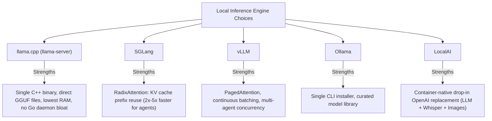
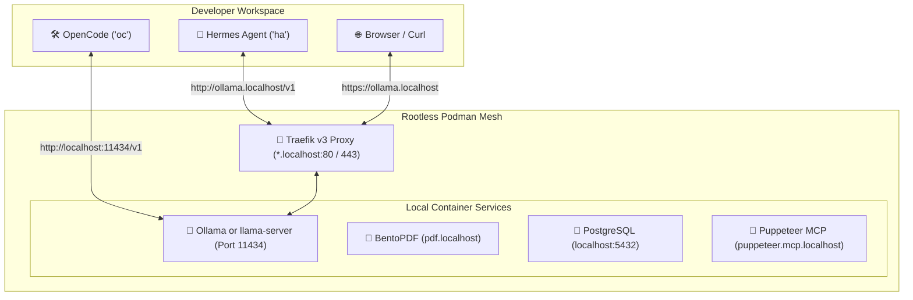

# 🚀 Feature Plan: AI Agent Model Providers & Local LLM Services

This document outlines the architectural plan, provider configurations, local inference engine evaluations, and implementation roadmap for expanding AI agent capabilities within the `setup-linux-scripts` development environment.

---

## 🎯 Executive Summary & Objectives

The current environment equips developers with two complementary agents:
* 🛠️ **[OpenCode](docs/opencode-hermes-guide.md#2-opencode-oc-scope--workflow)** (`opencode` / `oc`): Repository-centric pair programming and refactoring.
* 🤖 **[Hermes Agent](docs/opencode-hermes-guide.md#3-hermes-agent-ha-scope--workflow)** (`hermes` / `ha`): Autonomous system operator, background research, and cron automation.

### Planned Enhancements
1. **First-Class Gemini & Hosted LLM Support**: Expand Tier 1 (`install-dev-env.sh`) credential templates to include Google Gemini and multi-provider aggregators (OpenRouter, Groq).
2. **Local Lightweight LLM Support**: Enable offline, privacy-first, and zero-cost model inference for both agents via OpenAI-compatible endpoints (`http://localhost:11434/v1`).
3. **Tier 2 Local Service Integration**: Provision a containerized local inference engine inside the rootless Podman container mesh (`install-local-services.sh`), routed dynamically through Traefik v3 with `*.localhost` SSL and managed via `jl` task runner commands.

---

## ☁️ 1. Hosted LLMs & Gemini API Integration

Both OpenCode and Hermes Agent support hosted model providers beyond OpenAI and Anthropic.

### 1.1 Google Gemini Configuration
Google's Gemini models (such as `gemini-2.5-pro` and `gemini-2.0-flash`) offer massive context windows (up to 1M–2M tokens) and competitive pricing/free tiers.

* **Target File**: `~/.bashrc.local` (managed via [`.bashrc`](.bashrc#L148))
* **Environment Variables**:
  ```bash
  # Google Gemini API Credentials
  export GEMINI_API_KEY="AIzaSyYourGeminiApiKeyHere"
  export GOOGLE_GENERATIVE_AI_API_KEY="AIzaSyYourGeminiApiKeyHere"
  ```
* **Agent Integration**:
  * **OpenCode**: Select model via CLI flag (`oc --model gemini-2.5-pro`) or interactively with `/model`.
  * **Hermes Agent**: Configured via `hermes setup` or under `~/.hermes/config.yaml` using LiteLLM provider syntax (`gemini/gemini-2.0-flash`).

### 1.2 Multi-Provider Aggregators (OpenRouter / Groq / DeepSeek)
To access hundreds of models (including DeepSeek V3/R1, Claude 3.5, and Llama 3.3) under one billing key:
```bash
# OpenRouter (Unified Gateway)
export OPENROUTER_API_KEY="sk-or-v1-..."

# Groq (Ultra-Low Latency Inference)
export GROQ_API_KEY="gsk_..."
```

---

## 💻 2. Local Lightweight LLMs

Running models locally allows private, offline development and zero API cost for routine tasks like linting, git commit generation, and small refactors.

### 2.1 Recommended Models for Coding & Agent Workflows

| Model | Parameter Size | RAM / VRAM Req. | Best Use Case | Strengths |
| :--- | :--- | :--- | :--- | :--- |
| **`qwen2.5-coder:7b`** | 7 Billion | ~6–8 GB | Primary daily coding partner | State-of-the-art coding benchmark scores for its size, strong tool calling. |
| **`qwen2.5-coder:1.5b` / `3b`** | 1.5B / 3B | ~2–4 GB | Low-spec CPU / battery mode | Blazingly fast token generation on pure CPU. |
| **`llama3.2:3b`** | 3 Billion | ~3–4 GB | Hermes autonomous tasks & research | Strong instruction following, fast summarization, low memory footprint. |
| **`deepseek-coder-v2:lite`** | 16B (MoE) | ~14–18 GB | Complex multi-file refactoring | Mixture-of-Experts architecture with 236B-like coding quality at low active parameter cost. |

---

## ⚖️ 3. Local Inference Engine Evaluation: Ollama vs. Alternatives

While **Ollama** is popular for quick installs, several alternatives offer substantial advantages for developers and agentic workflows:



### Detailed Engine Comparison

| Feature | `Ollama` | `llama-server` (`llama.cpp`) | `SGLang` | `vLLM` | `LocalAI` |
| :--- | :--- | :--- | :--- | :--- | :--- |
| **Underlying Runtime** | `llama.cpp` (wrapped in Go) | Native C++ | Python / CUDA / C++ | Python / CUDA / C++ | Go + C++ bindings |
| **Memory Footprint** | Moderate (daemon overhead) | **Minimal** | High (VRAM hungry) | High (VRAM hungry) | Moderate |
| **Model Storage** | Opaque internal blobs | **Direct `.gguf` files** | Safetensors / AWQ / FP8 | Safetensors / AWQ / FP8 | GGUF / HuggingFace |
| **Prompt Prefix Caching** | Limited | Basic slot reuse | **RadixAttention (Best for agents)** | PagedAttention | Basic |
| **Ideal Hardware** | CPU, Metal, basic GPU | CPU, Apple Silicon, any GPU | Dedicated NVIDIA GPU | Dedicated NVIDIA/AMD GPU | CPU / Container Host |
| **Agent Suitability** | Good | **Excellent (Lean & direct)** | **Best (Ultra-fast multi-turn)** | High throughput | Good |

### Verdict
1. **Default Local Engine Recommendation for CPU / macOS / Modest Systems**:
   **`llama.cpp` (`llama-server`)**: Eliminates the Go daemon overhead of Ollama, loads any `.gguf` directly without model import steps, and provides an exact OpenAI-compatible API.
2. **Power-User Recommendation for Dedicated NVIDIA GPUs**:
   **`SGLang`**: The **RadixAttention** engine delivers massive speedups for agents because OpenCode and Hermes repeatedly re-transmit system prompts, codebase context, and tool histories. SGLang reuses the existing KV cache across turns rather than re-computing tokens.

---

## 🏗️ 4. Tier 2 Local Services Integration Architecture

Local LLM engines can be hosted directly inside the user-space container mesh provided by [`install-local-services.sh`](install-local-services.sh) and controlled with the `jl` task runner.

### 4.1 Architecture Diagram



### 4.2 Compose Configuration Snippet
Add the local LLM service to `~/.local/share/local-services/docker-compose.yml`:

```yaml
  # 🦙 Local LLM Inference Service (Ollama / llama-server)
  ollama:
    image: ollama/ollama:latest
    container_name: local-ollama
    restart: unless-stopped
    ports:
      - "11434:11434"
    volumes:
      - ollama-models:/root/.ollama
    networks:
      - local-mesh
    labels:
      - "traefik.enable=true"
      - "traefik.http.routers.ollama.rule=Host(`ollama.localhost`)"
      - "traefik.http.routers.ollama.entrypoints=web,websecure"
      - "traefik.http.routers.ollama.tls=true"
      - "traefik.http.services.ollama.loadbalancer.server.port=11434"
      - "io.containers.autoupdate=registry"

volumes:
  postgres-data:
  ollama-models:
```

### 4.3 Container vs. Bare-Metal Host Deployment Decision
* **Containerized via `jl`**:
  * **When to use**: Standard CPU inference, cloud VPS deployment, unified service lifecycle management (`jl up` / `jl down`), automatic Traefik SSL (`https://ollama.localhost`).
* **Bare-Metal Installation (Host)**:
  * **When to use**: Machines with dedicated hardware acceleration (NVIDIA CUDA, AMD ROCm, Apple Metal).
  * **Why**: Running directly on the host bypasses rootless container device mapping complexity (`--device nvidia.com/gpu=all` and CDI specifications).

---

## 🗺️ 5. Implementation Roadmap

### Phase 1: Tier 1 Credential Stubs (`bootstrap.sh` & `~/.bashrc.local`)
* [x] Update the `~/.bashrc.local` stub generator in [`bootstrap.sh`](bootstrap.sh#L635) and host `~/.bashrc.local` to include:
  ```bash
  # Google Gemini (https://aistudio.google.com/app/apikey)
  # export GEMINI_API_KEY="your-gemini-api-key"
  # export GOOGLE_GENERATIVE_AI_API_KEY="$GEMINI_API_KEY"

  # OpenRouter Unified Multi-Model Gateway (https://openrouter.ai/keys)
  # export OPENROUTER_API_KEY="your-openrouter-key"

  # Groq Ultra-Low Latency Inference (https://console.groq.com/keys)
  # export GROQ_API_KEY="your-groq-key"

  # Local LLM Backend (Ollama / llama-server / vLLM)
  # export OPENAI_BASE_URL="http://localhost:11434/v1"
  # export OPENAI_API_KEY="ollama"
  ```
* [x] Update [`docs/opencode-hermes-guide.md`](docs/opencode-hermes-guide.md) with model-switching examples for Gemini and local backends.

### Phase 2: Tier 2 Local Service Mesh (`local-services/justfile` & `bootstrap.sh`)
* [x] Add an optional `--with-llm` flag in [`bootstrap.sh`](bootstrap.sh) to scaffold and launch the Ollama container.
* [x] Add model management tasks to `justfile` ([`local-services/justfile`](local-services/justfile#L67)):
  * `jl llm-pull <model>`: Pull a model into the container (using portable `{{CONTAINER_CMD}}`).
  * `jl llm-list`: List downloaded models.
  * `jl llm-status`: Check inference engine health and memory usage.
  * `jl llm-models`: Show recommended models for OpenCode and Hermes.
  * `jl llm-test`: Verify OpenAI-compatible API connectivity.

### Phase 3: Verification & Diagnostics
* [x] Add an end-to-end connectivity check command (`jl llm-test`):
  ```bash
  curl -s http://localhost:11434/v1/models | jq .
  ```
* [x] Graceful fallback handling in shell wrapper (`home/shell.nix`) supporting host Ollama and container fallback.

---

### Phase 4: Automated Tailscale Auth Key Rotator (OAuth-Driven & Multi-Recipient SOPS)
*Reference: [How I Built a Tailscale Auth Key Rotator by Brent Gruber](https://medium.com/@brent.gruber77/how-i-built-a-tailscale-auth-key-rotator-814722b839e0)*

* **Goal**: Eliminate manual 90-day key expiration friction for containerized Tailscale ingress nodes by automating key rotation with scoped OAuth clients and distributing encrypted keys via GitOps.
* **Architecture**:
  * **OAuth Generation**: Use a Tailscale OAuth client with least-privilege `keys:write` scope to programmatically mint 90-day reusable auth keys.
  * **Multi-Recipient SOPS Encryption**: Encrypt `secrets/tailscale.enc.yaml` against the native `ssh-ed25519` public keys of all authorized laptops (`asus`, `envy`, `arch`). No private keys ever leave their respective hosts or travel across the network.
  * **Self-Healing Local Consumption (Lazy On-Demand Fetch)**:
    * Local machines do not require background daemons or continuous polling.
    * When `jl up-remote` detects an expired token or authentication error, it automatically executes a targeted `git pull` on `secrets/tailscale.enc.yaml`, decrypts the new key with the local host's SSH key, updates `~/.local/share/local-services/.env`, and brings up the nodes seamlessly.

---

### Phase 5: Declarative Dependency Manifests & Auto-Sync across Language Templates
* **Objective**: Replicate the Python template's dual-condition auto-sync pattern across all existing and future language templates (`node`, `rust`, `kubernetes`, etc.).
* **Design Principles**:
  1. **Graceful Zero-Error Missing File Handling**: Never crash or error out when manifest files are missing upon initial template scaffolding.
  2. **Developer Guidance & Best-Practice Warnings**: Display a friendly terminal banner in `enterShell` encouraging developers to declare dependencies in the standard language manifest (e.g., `package.json`, `Cargo.toml`, `go.mod`).
  3. **Automatic Change Detection (`watch_file`)**: Pre-populate `.envrc` with `watch_file` for standard language manifests so `direnv` automatically picks up file creation or edits without requiring manual `.envrc` modifications.
  4. **Fast Native Package Syncing**: Automatically run the fast native package manager (`pnpm install`, `cargo check`, etc.) upon file detection.
* **Target Templates Reviewed & Enhanced**:
  * [x] **Python** (`templates/python`): Watch `requirements.txt`, `pyproject.toml`. Auto-syncs via `uv pip install` / `uv sync`; friendly guidance if missing.
  * [x] **Node / TypeScript** (`templates/node`): Watch `package.json`, `pnpm-lock.yaml`. Auto-syncs via `pnpm install`; friendly warning to run `pnpm init` if missing.
  * [x] **Rust** (`templates/rust`): Watch `Cargo.toml`, `Cargo.lock`. Auto-validates via `cargo check`; guidance to run `cargo init` if missing.
  * [x] **Kubernetes / CKAD** (`templates/kubernetes`): Watch `kustomization.yaml`, `Chart.yaml`, `values.yaml`. Context-aware guidance for Kustomize overlays and Helm charts.
  * [x] **Go** (`templates/go`): Watch `go.mod`, `go.sum`. Auto-syncs via `go mod download`; friendly guidance if missing; includes `gopls`, `golangci-lint`, `delve`.
  * [x] **Rust & WebAssembly / WASM** (`templates/rust-wasm`, alias `#wasm`): Watch `Cargo.toml`, `Cargo.lock`. Cross-compiles to `wasm32-unknown-unknown`; includes `wasm-pack`, `wasm-bindgen-cli`, `binaryen`, `wabt`.
  * [x] **TypeScript & Effect-TS** (`templates/ts-effect`, alias `#effect`): Watch `package.json`, `pnpm-lock.yaml`, `tsconfig.json`. Node 22, pnpm, tsx, Biome, and Effect ecosystem guidance.
  * [x] **Scala 3 & ZIO** (`templates/scala-zio`, alias `#zio`): Watch `build.sbt`, `project/build.properties`, `project.scala`. Includes Java 21 LTS, sbt, scala-cli, scalafmt, and Metals LSP.

---

### Phase 6: Herdr Terminal Multiplexer & Multi-Agent Orchestration (Track A Active Priority)
* **Goal**: Integrate **Herdr** (`herdrdev/herdr`, written in Rust) as the dedicated agent terminal multiplexer and supervisor runtime (`herdr-core` / `hc`), providing session persistence, an attention queue, and programmatic subagent delegation for **Hermes Agent** (`ha`) and **OpenCode** (`oc`).
* **Key Architecture & Capabilities**:
  1. **Supervisor Runtime (Layer 2)**:
     * Does **not** replace Hermes or OpenCode.
     * Operates as the underlying terminal multiplexer and background supervisor (replacing raw `tmux` for AI workloads).
  2. **Agent-Aware Attention Queue**:
     * Detects agent lifecycle states (`working`, `blocked / needs input`, `idle`, `done`).
     * Aggregates multiple concurrent agents into a unified notification inbox, alerting the developer only when human decision or approval is needed.
  3. **Headless Session Persistence**:
     * `herdr-core` runs as a background daemon, ensuring long-running refactoring sweeps, research tasks, and benchmarks survive terminal closures or SSH disconnects.
  4. **Inter-Agent Subagent Delegation API**:
     * Exposes a Unix socket and CLI API (`hc spawn`, `hc send`, `hc wait`) allowing Hermes to autonomously spawn helper agent panes (e.g., launching OpenCode in an isolated Git worktree) and collect results.
  5. **Remote Mobile / Web Supervision (Ovis)**:
     * Connects with companion web/mobile clients over Tailscale, enabling developers to review diffs and approve actions on mobile devices.
* **Implementation Deliverables**:
  * [ ] Add `herdr` installation / build recipe via Cargo / GitHub release to Tier 1 (`install-dev-env.sh` / `home/packages.nix`).
  * [ ] Add shell aliases and environment variables in `home/shell.nix`.
  * [ ] Add task runner management commands in `local-services/justfile` (`jl herdr-up`, `jl herdr-status`, `jl herdr-down`).
  * [ ] Document multi-agent workflows in `docs/opencode-hermes-guide.md`.

---

### Phase 7: "System One" Decision Models: Laya & Respan (Span-01/02) (Track A Follow-Up)
* **Goal**: Explore and evaluate non-autoregressive, low-latency discriminative decision models as open-source, local alternatives to proprietary "System One" APIs (such as TypeSafe AI Jev / `yev.ai`).
* **Why "System One" Decision Models**:
  * Unlike generative LLMs that generate prose token-by-token (200ms–1500ms), decision models evaluate input context in a **single non-autoregressive forward pass (5ms–25ms)**.
  * Return typed, calibrated outputs (`Choice`, `Score`, `Noul` / Boolean) for instant agent routing, code search relevance, and test pass/fail judging.
* **Target Technologies for Evaluation**:
  1. **Laya** (ModernBERT-large & mmBERT):
     * 100% open-source, multilingual (100+ languages), optimized for CPU-friendly triage.
     * Primary use case: Offline task/intent routing and `jevgrep`-style semantic code file triage.
  2. **Respan (Span-01 & Span-02)**:
     * Open-weight decision and judging models.
     * `Span-01`: Specialized for AI agent trace evaluation and automated grading of test runs / PR diffs.
     * `Span-02`: Specialized for runtime application decision-making and policy guardrails.
  3. **Kev / SemIf (Fallback & Comparison)**:
     * Compare against Kev (Qwen + LoRA adapter) and SemIf (direct LLM logit extraction).
* **Implementation Deliverables**:
  * [ ] Prototype Laya local inference on CPU/GPU via Python/ONNX microservice or container in `local-services/docker-compose.yml`.
  * [ ] Benchmark latency and calibration vs. local Ollama grammar-constrained models.
  * [ ] Wire decision endpoint into OpenCode / Hermes search and verification loops (`jevgrep` equivalent).


